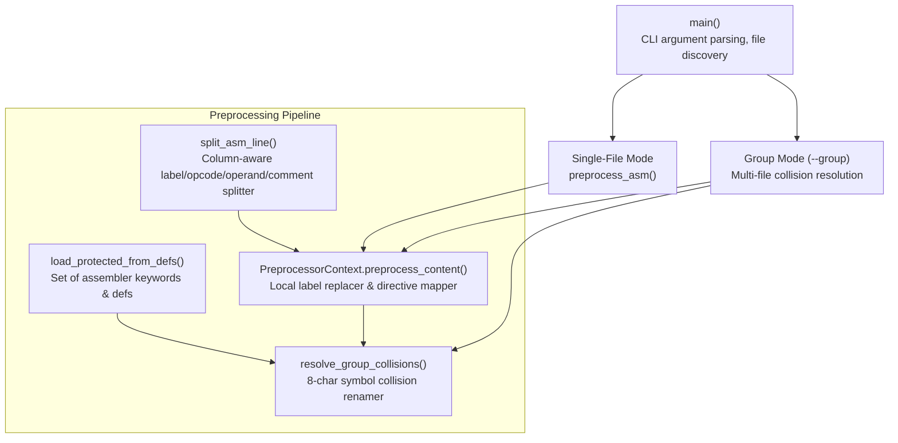
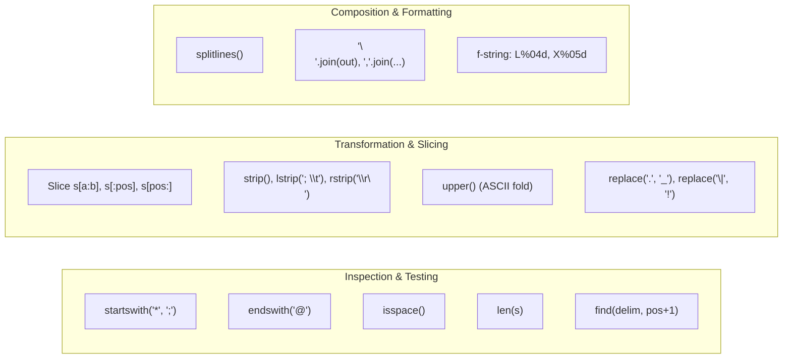
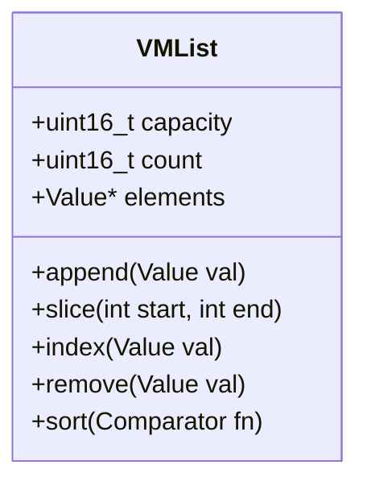
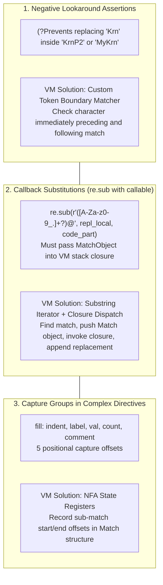
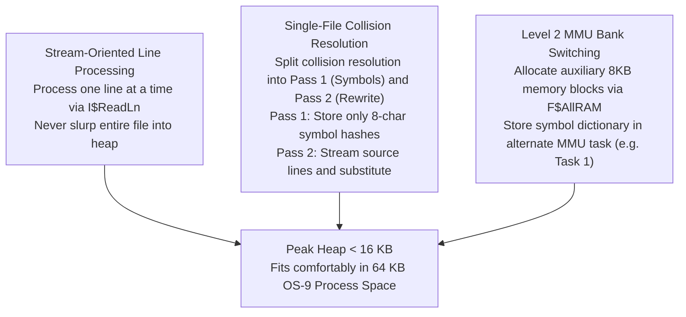

# Architectural Analysis: P-Code Virtual Machine for `selfgen_preprocess.py`

## 1. Executive Summary

This document provides a comprehensive technical analysis of [`recipes/deep65280/selfgen_preprocess.py`](file:///home/strick/modoc/coco-shelf/nitros9/recipes/deep65280/selfgen_preprocess.py) from the perspective of designing and implementing a **P-Code Virtual Machine (VM)** and runtime engine capable of executing the program when compiled into a bytecode/P-code intermediate representation.

In the NitrOS-9 self-hosting architecture, `selfgen_preprocess.py` bridges the gap between modern cross-assembler source code (LWASM dialect) and the native 6809/6309 Microware / Curtis Boyle assembler (`asm`). Today, this script runs on the host development machine in standard Python 3. If native self-hosting is to be fully independent of host Python, an equivalent preprocessor must be capable of running either directly under NitrOS-9 (on a physical 6809/6309 CPU with 64 KB per-process address space) or within an embedded P-code runtime (e.g. on an RP2350 microcontroller or inside an OS-9 virtual machine).

This analysis determines:
- Every data type, arithmetic primitive, and collection operation required by the script.
- The regular expression engine features and complexity footprint.
- File system and operating system interfaces required.
- Dynamic runtime semantics (closures, object state, exceptions, context managers).
- Concrete instruction set architecture (ISA) recommendations for a custom P-code interpreter.
- Memory constraints, working set sizing, and practical optimization strategies for 8-bit / 16-bit target environments.

---

## 2. Program Structure & Functional Inventory

The script comprises 370 lines of Python 3, divided into five main functional sections:



### Functional Component Breakdown

| Function / Component | Lines | Primary Purpose | Key Language Features Exercised |
| :--- | :--- | :--- | :--- |
| `DEFAULT_PROTECTED` | 26–31 | Constant set of 38 6809/6309 registers and assembler keywords | Set literal initialization, string hashing / lookup |
| `load_protected_from_defs` | 33–46 | Parses OS-9 definition files (`defsfile`) to extract exported symbols | File streaming (`for line in f`), line splitting, regex identifier extraction, set mutation (`add`) |
| `split_asm_line` | 48–95 | Deconstructs an assembly line into code and comment portions while preserving column layout | String slicing, stripping (`rstrip`, `lstrip`), searching (`find`), whitespace detection (`isspace`), regex matching (`\S+`), string length |
| `PreprocessorContext` | 97–230 | State-tracking preprocessor class; replaces `@`-local labels, expands `fill`, maps directives, truncates lines | OOP (instance state `self.global_instance_id`), nested closure (`repl_local`), regex substitution with callback, integer parsing (`int(val, 0)`), string methods, list mutation |
| `resolve_group_collisions` | 232–299 | Discovers defined column-0 symbols across all target files, groups by first 8 uppercase characters, and replaces conflicting symbols with unique IDs | Dictionaries of lists (`setdefault`), sorting with custom lambda keys (`key=lambda x: len(x[0])`, `reverse=True`), deduplication (`dict.fromkeys`), regex lookaround assertions (`(?<!...)`, `(?!...)`) |
| `preprocess_asm` | 301–303 | Helper wrapper instantiating `PreprocessorContext` | Class instantiation, method dispatch |
| `main` | 305–369 | CLI driver supporting `--defs`, `--no-collisions`, `--group`, and single-file positional arguments | `sys.argv` slicing, list search (`index`, `in`, `remove`), `os.path` operations, `os.makedirs`, whole-file slurp/write (`read`, `write`) |

---

## 3. Arithmetic & Numeric Operations

Although `selfgen_preprocess.py` is primarily a text-processing engine, it performs essential numeric and arithmetic tasks that dictate the VM's numeric model.

### 3.1 Numeric Data Types & Precision
- **Signed Integer**: A 16-bit signed integer (`int16_t`, range $-32,768 \dots +32,767$) is sufficient for line numbers, column indices, string lengths, and loop counters, as individual source files rarely exceed 32,000 lines.
- **Unsigned Word / 32-bit Integer**: When expanding assembly `fill <val>,<count>`, count expressions can theoretically represent 16-bit memory spans (e.g. `fill 0,65280` or `$FFE0`). A **32-bit integer** (`int32_t`) or unsigned 16-bit integer is required for `count` arithmetic.
- **Radix Autodetection (`int(count, 0)`)**:
  - The script uses `int(count, 0)` to convert numeric counts in `fill` directives.
  - The VM must parse base-10 (`1234`), base-16 (`0x1A2B`), and base-8 (`0o755`).
  - *Assembly extension requirement*: Native OS-9 sources also use `$` for hex (`$20`) and `%` for binary (`%00100011`).

### 3.2 Required Arithmetic & Logic Operations

| P-Code Operation | Python Source Reference | Description / Stack Effect |
| :--- | :--- | :--- |
| `ADD` / `SUB` | `pos += m.end()`, `c -= chunk`, `counter += 1`, `line_idx + 1` | Standard integer addition and subtraction |
| `MUL` | `[val] * chunk` | List element repetition by integer multiplier |
| `MIN` / `MAX` | `min(c, 16)`, `max(0, 78 - len(code_part))` | Numeric bounding for comment line wrapping and fill chunks |
| `CMP_EQ`, `CMP_NE` | `c > 0`, `len(unique_syms) > 1`, `len(s) <= 8`, `pos != -1` | Integer relational comparisons yielding Boolean results |
| `CMP_LT`, `CMP_GT` | `j < len(lines)`, `total_len > 78` | Relational ordering tests |
| `BIT_OR`, `BIT_AND` | CAS expression simplification ($23) | Bitwise logic for numeric constants |
| `PARSE_INT_RADIX` | `int(count, 0)` | Converts string token to integer with radix detection; raises `ValueError` on failure |

---

## 4. String Operations & String Representation

Strings represent over 70% of all operations executed by `selfgen_preprocess.py`. The VM’s string model determines the overall performance, memory usage, and garbage collection overhead.

### 4.1 String Memory Architecture in the VM
In a memory-constrained environment (such as a 6809 running NitrOS-9 with a 64 KB limit), strings cannot be recklessly allocated as immutable copies. The VM needs:
1. **String Descriptors / String Views (`string_view`)**:
   - `struct StringView { uint16_t offset; uint16_t length; }` referencing a shared line buffer.
   - Slices like `s[:pos]` and `s[pos:]` in `split_asm_line` can avoid heap allocations by referencing slices within the existing line buffer.
2. **Dynamic Heap Strings**:
   - Resizable byte buffers for concatenated output, line accumulation, and symbol replacement.
3. **String Interning Pool**:
   - An internal atom table for assembler keywords (`RMB`, `FCB`, `EQU`, `USE`, `CAS`), register names, and frequent prefixes (`L0001`, `X00001`).

### 4.2 Comprehensive String Operation Inventory



| Operation Category | Python Method / Construct | Occurrences in Source | VM Implementation Requirement |
| :--- | :--- | :--- | :--- |
| **Inspection** | `s.startswith(prefix)` | Lines 55, 117, 121 | Memory comparison of string prefix with literal |
| | `s.endswith(suffix)` | Line 249 (`lbl.endswith("@")`) | Boundary check + tail comparison |
| | `s.isspace()` | Lines 39, 60 | Character loop checking `c <= ' '` (spaces, tabs, CR, LF) |
| | `s.find(delim, start)` | Line 84 (`s.find(delim, pos + 1)`) | Linear byte scan starting from index; returns -1 on not found |
| | `len(s)` | Lines 88, 139, 225, 267, 288 | 16-bit string length query |
| **Trimming** | `s.rstrip('\r\n')` | Line 53 | Scans backwards from end of string; returns truncated view |
| | `s.lstrip()` / `s.lstrip('; \t')` | Lines 54, 118 | Scans forward past whitespace or specified character set |
| | `s.strip()` | Lines 108, 140, 160, 176, 177 | Combines lstrip and rstrip |
| **Slicing & Indexing** | `s[0]`, `s[pos]` | Lines 39, 60, 83 | Direct byte index access with bounds verification |
| | `s[:pos]`, `s[pos:]` | Lines 65, 71, 76, 90, 93, 94 | Substring generation via offset and length |
| | `s[:8]`, `s[:2]`, `clean_name[:2]` | Lines 203, 208, 215, 258 | Prefix truncation |
| **Case Conversion** | `s.upper()` | Lines 45, 72, 222, 251, 258, 267 | In-place or copy conversion of lowercase ASCII (`a`–`z` $\rightarrow$ `A`–`Z`) |
| **Replacement** | `s.replace('.', '_')` | Lines 200, 212 | Byte substitution of target character with replacement |
| | `s.replace('\|', '!')` | Line 223 | Replaces pipe operator with OS-9 pipe exclamation point |
| **Splitting & Joining**| `content.splitlines()` | Lines 102, 237 | Tokenizes large buffer by `\n` or `\r\n` into array of lines |
| | `"\n".join(out) + "\n"` | Line 230, 297 | Concatenates list of string lines with newline delimiters |
| | `",".join([val] * chunk)` | Line 183 | Intersperses comma between array elements |
| **Formatting** | `f"L{self.global_instance_id:04d}{clean_name[:2]}"` | Lines 203, 208, 215 | Formatted integer (%04d) + truncated string interpolation |
| | `f"X{counter:05d}"` | Line 270 | 5-digit zero-padded integer formatting |
| | `f"{lbl_part}* PREPROCESSED FILL..."` | Lines 180, 183, 189 | Multi-field string template interpolation |

---

## 5. List, Dictionary & Set Collection Operations

`selfgen_preprocess.py` utilizes dynamic collections for line queues, symbol collision tables, and keyword sets.

### 5.1 List / Dynamic Sequence Operations
Lists are used as ordered line buffers, command-line arguments, and grouped symbol entries.



- **`out.append(...)`** (Lines 113, 119, 123, 128, 142, 180, 228): Dynamic appending to dynamic arrays; requires automatic resizing (doubling capacity).
- **`lines[j]` / `enumerate(lines)`** (Lines 107, 138, 242): Forward indexing and iteration.
- **`[val] * chunk`** (Line 183): Array creation initialized by repeated copies of an element.
- **`args[:idx] + args[idx + 2:]`** (Line 321): List slicing and list concatenation (`CONCAT_LIST`).
- **`args.index("--defs")` / `"--no-collisions" in args`** (Lines 315, 319, 326): Linear scan for value containment and index lookup.
- **`args.remove("--no-collisions")`** (Line 316): In-place item removal shifting remaining elements left.
- **`sorted(rename_map.items(), key=lambda x: len(x[0]), reverse=True)`** (Line 280): Custom stable sort (Timsort or Quicksort) executing a user-provided comparison lambda with reverse flag.
- **`list(dict.fromkeys(sym_list))`** (Line 264): Order-preserving list deduplication.

### 5.2 Dictionary Operations
Dictionaries are used to track local label scopes, multi-file contents, and symbol collisions.

- **Hash Table Structure**:
  - Keys are strings (`bname`, `lbl`, `name`, `pfx`).
  - Values vary: strings, integers, Booleans, lists, or nested dictionaries.
- **`local_map = {}`** (Line 104, 112): Instant clearing of table on scope change (empty line in assembly).
- **`dict.setdefault(key, []).append(...)`** (Lines 253, 259):
  - If key does not exist, inserts empty list; returns list reference; appends new element.
- **Nested Lookups**:
  ```python
  local_map[name]['label']
  local_map[name]['defined'] = True
  ```
  Requires VM to handle multi-level dictionary dereferencing.
- **Dictionary Iteration**:
  - `dict.keys()` (Line 257)
  - `dict.items()` (Lines 241, 263, 280, 283, 341)

### 5.3 Set Operations
Sets are used for fast $O(1)$ membership testing against protected keywords and defined symbols.

- **`DEFAULT_PROTECTED`**: Constant set of 38 strings initialized at module load.
- **`set(DEFAULT_PROTECTED)`** (Line 34): Shallow copy of an existing set.
- **`protected.add(sym)`** (Lines 44, 45): Insertion of new symbol strings.
- **`lbl in protected_symbols or lbl.upper() in protected_symbols`** (Lines 251, 272): Fast hash membership check.

---

## 6. Regular Expression Subsystem Requirements

The regular expression engine is the most sophisticated dependency in `selfgen_preprocess.py`. The script uses 24 distinct regex patterns ranging from simple character classes to lookaround assertions and callback substitutions.

### 6.1 Complete Regex Inventory & Complexity Classification

| Category | Regex Pattern in Source | Usage Location | Engine Feature Required |
| :--- | :--- | :--- | :--- |
| **Simple Word / Token Match** | `^([A-Za-z0-9_.]+)` | Line 41, 246 | Character class, start anchor `^`, capture group 1 |
| | `^\S+` | Line 61, 71, 90 | Negated whitespace class `\S`, start anchor |
| | `\S` | Line 65, 76 | Find first non-whitespace character in substring |
| | `^L\d{4}` | Line 249 | Digit class `\d`, exact quantifier `{4}` |
| **Directive Detectors** | `^\s*dts\b` | Line 127 | Optional whitespace, word boundary `\b`, case-insensitive |
| | `^\s*use\s+(os9\.d\|scf\.d\|rbf\.d)\b` | Line 132 | Alternation `\|`, escaped dots `\.`, word boundary |
| | `^\s*ifp1\b`, `^\s*endc\b` | Lines 137, 146 | Anchored directive search |
| | `^\s*use\s+defsfile\b` | Line 141 | Substring directive matching |
| | `^\s+ERROR\b` | Line 159 | Leading whitespace quantifier `\s+` (distinguishes label from opcode) |
| **Substitutions** | `\bIFNDEF\b` $\rightarrow$ `IFNDF` | Line 152 | Word boundary replacement, case-insensitive |
| | `^\s*endif\b` $\rightarrow$ ` endc` | Line 153 | Leading whitespace replacement |
| | `#'(.)'` $\rightarrow$ `#'\1` | Line 156 | Backreference replacement group `\1` |
| | `\bCLOCK_AND_STOP\.Exit0\b` | Line 164 | Escaped dot, word boundary replacement |
| | `\(CAS\.R6Hz\|CAS\.IRQEn\|CAS\.Tick\)` | Line 168 | Escaped parentheses and pipes, literal substitution |
| **Complex Grammars** | `^(\s*)(\w*)\s+fill\s+([^,]+),([^;]+)(.*)$` | Line 172 | 5 capture groups: indent, label, value, count, trailing comment |
| | `^([A-Za-z0-9_.]+?)@(?:\s\|$)` | Line 197 | Non-greedy quantifier `+?`, non-capturing group `(?:...)`, end anchor or space |
| **Callback Substitution** | `\b([A-Za-z0-9_.]+?)@` | Line 218 | Replaces every occurrence using user function `repl_local(m)` |
| **Lookaround Assertions** | `(?<![A-Za-z0-9_.])` + `old_sym` + `(?![A-Za-z0-9_.])` | Line 290 | **Negative Lookbehind** (`?<!`) + **Negative Lookahead** (`?!`) for symbol isolation |

### 6.2 The Three Critical Regex Challenges for a Lightweight VM



1. **Negative Lookbehind & Lookahead**:
   - Standard DFA engines cannot handle lookaround assertions.
   - *VM Optimization*: Notice that `(?<![A-Za-z0-9_.])SYM(?![A-Za-z0-9_.])` is simply a custom **identifier boundary test**. Rather than requiring a full generalized lookaround regex engine, the VM can support an optimized opcode:
     `STR_REPLACE_IDENT(old_sym, new_sym, id_char_class)`.
2. **Callback Substitutions (`repl_local`)**:
   - The regex engine must interrupt its scanning loop, construct a `Match` object, push it onto the VM stack, execute the inner VM function `repl_local`, retrieve the string result from the stack, and substitute it into the output buffer.
3. **Regex Engine Architecture Choice**:
   - A minimalist bytecode-based NFA engine (e.g. Rob Pike's regex VM or a Thompson NFA) of approximately 500–800 lines of C or assembly can easily handle 23 of the 24 patterns.
   - The symbol boundary replacement (Line 290) can be executed as a dedicated token replacement primitive.

---

## 7. File System & OS System Call Interfaces

The preprocessor interacts with the host environment to manage input sources and write preprocessed files.

### 7.1 Required OS & File Primitives

| Python Call | Purpose in Script | OS-9 System Call Equivalent | Linux / POSIX Equivalent |
| :--- | :--- | :--- | :--- |
| `open(path, "r")` | Open source file for reading | `os9 I$Open (Read)` | `open(path, O_RDONLY)` |
| `open(path, "w")` | Open/create output file for writing | `os9 I$Create (Write+Read)` | `open(path, O_WRONLY\|O_CREAT\|O_TRUNC)` |
| `f.read()` | Slurp entire file into memory buffer | Loop on `os9 I$Read` | `read(fd, buf, size)` |
| `for line in f:` | Stream file line-by-line | Loop on `os9 I$ReadLn` | `fgets` / `getline` |
| `f.write(content)` | Write string data to file | Loop on `os9 I$Write` | `write(fd, buf, len)` |
| `f.close()` | Close file handle | `os9 I$Close` | `close(fd)` |
| `os.path.isfile(path)` | Check if definition file exists | `os9 I$Open` test or `I$GetStt` | `stat(path, &st)` |
| `os.path.basename(path)` | Extract file name from directory path | String scan backwards for `/` | `basename(path)` |
| `os.path.join(dir, file)` | Join directory and file with `/` | String concatenate with `/` | Concatenate with `/` |
| `os.makedirs(dir, exist_ok=True)` | Create destination directories | `os9 I$MakDir` | `mkdir -p` |
| `sys.argv[1:]` | Access command-line parameters | Parse parameter string from `F$Fork` / `F$Chain` | `argc` / `argv` |
| `sys.exit(code)` | Terminate with return status | `os9 F$Exit` (status in B) | `exit(code)` |
| `print(msg)` | Write diagnostic message to stdout | `os9 I$WriteLn` on path 1 | `write(1, msg, len)` |

---

## 8. Dynamic Language Runtime & VM Semantics

To execute the compiled bytecode of `selfgen_preprocess.py`, the VM runtime must provide several high-level language capabilities.

### 8.1 Closures & Nested Functions (`repl_local`)
Inside `PreprocessorContext.preprocess_content`:
```python
def repl_local(m):
    name = m.group(1)
    clean_name = name.replace('.', '_')
    if name not in local_map:
        self.global_instance_id += 1
        local_map[name] = {'label': f"L{self.global_instance_id:04d}{clean_name[:2]}", 'defined': False}
    return local_map[name]['label']
```
- `repl_local` is a closure referencing:
  - `self` (the `PreprocessorContext` instance).
  - `local_map` (a dictionary defined in the enclosing function scope).
- **VM Requirement**: The VM must support **Lexical Closures** (`LOAD_DEREF`, `STORE_DEREF`) via cell objects or activation frame pointers, allowing inner functions to mutate variables in their parent frame.

### 8.2 Object Model & Method Dispatch
- `PreprocessorContext` requires a minimal class/instance system:
  - Object instantiation (`MAKE_INSTANCE`).
  - Instance variable storage (`LOAD_ATTR`, `STORE_ATTR` for `self.global_instance_id`).
  - Method binding and dispatch (`CALL_METHOD` for `ctx.preprocess_content(...)`).

### 8.3 Exception Handling (`try ... except ValueError`)
- Used on Line 178 when attempting to parse symbolic fill counts:
  ```python
  try:
      c = int(count, 0)
      ...
  except ValueError:
      ...
  ```
- **VM Requirement**:
  - `SETUP_EXCEPT <target_addr>`: Pushes exception handler block to the execution stack.
  - `POP_EXCEPT`: Pops the exception handler upon normal block completion.
  - `RAISE_EXCEPTION <type>`: Unwinds operand stack to top handler if parsing fails.

### 8.4 Context Managers (`with open(...) as f:`)
- **VM Requirement**:
  - `SETUP_WITH`: Evaluates expression, calls `__enter__`, pushes cleanup handler.
  - `WITH_CLEANUP`: Ensures `f.close()` is executed upon block exit or exception unwinding.

---

## 9. Memory Footprint Analysis for OS-9 / 6809

A primary consideration for compiling `selfgen_preprocess.py` to run natively under NitrOS-9 on a physical or emulated 6809/6309 CPU is the **64 KB process memory limit**.

### 9.1 Memory Demand of Current Python Implementation

Let us evaluate the memory required when processing typical NitrOS-9 modules:

| NitrOS-9 Source File | Raw Source Size | Lines | In-Memory `splitlines` Strings | Preprocessed String | Peak Heap Working Set |
| :--- | :--- | :--- | :--- | :--- | :--- |
| `setime.asm` | 4.2 KB | 130 lines | ~6 KB | ~5 KB | ~25 KB |
| `scf.asm` | 24.8 KB | 820 lines | ~35 KB | ~30 KB | ~110 KB (Exceeds 64 KB!) |
| `rbf.asm` | 54.2 KB | 1,750 lines | ~75 KB | ~65 KB | ~240 KB (Exceeds 64 KB!) |
| `--group` (31 files) | ~450 KB | ~14,000 lines | ~650 KB | ~550 KB | ~2.5 MB (Exceeds 64 KB!) |

> [!CAUTION]
> **A naive, direct port of `selfgen_preprocess.py` that slurps entire files into memory (`f.read()`) and holds all files in a global dictionary (`files_dict`) will immediately crash on OS-9 Level 1 and Level 2 due to 64 KB memory exhaustion.**

### 9.2 Memory Optimization Strategies for the P-Code VM

To make this P-Code VM viable on 6809 / NitrOS-9:



1. **Line-Streaming Architecture**:
   - Replace `raw = f.read(); lines = raw.splitlines()` with line-by-line processing via `os9 I$ReadLn`.
   - Each line is read into a fixed 128-byte buffer, transformed, and immediately written out via `os9 I$WriteLn`.
   - Reduces the working line buffer memory to less than 1 KB!
2. **Two-Pass Symbol Collision Resolution**:
   - In `--group` mode, do not keep all files in `files_dict`.
   - **Pass 1**: Scan all input files line-by-line; extract only column-0 labels; store only the symbol name and an 8-byte hash in a compact symbol table.
   - **Pass 2**: Rewind or reopen each file, stream lines through the preprocessor, perform the string replacements using the computed `rename_map`, and write to destination files.
   - Peak heap memory for 1,000 symbols: $\approx 1,000 \times 16\text{ bytes} = 16\text{ KB}$.
3. **Level 2 MMU Bank Switching**:
   - On NitrOS-9 Level 2 (`deep65280`), the system has 256 KB–2 MB of physical RAM.
   - The VM can use `F$AllRAM` to allocate dedicated 8 KB RAM blocks in other MMU slots, using them as an external symbol table and dictionary cache while keeping the main P-code execution space under 32 KB.

---

## 10. Proposed P-Code Virtual Machine Specification

Based on the preceding operational requirements, here is the architectural specification for a custom P-Code VM tailored to execute the compiled preprocessor.

### 10.1 VM Register Model

```text
+-----------------------------------------------------------+
| IP: Instruction Pointer (16-bit)                          |
| SP: Operand Stack Pointer (16-bit)                        |
| FP: Frame Pointer / Local Variables Base (16-bit)         |
| CP: Constant Pool Base Pointer (16-bit)                   |
| EP: Exception Handler Stack Pointer (16-bit)              |
+-----------------------------------------------------------+
```

- **Execution Model**: Dual-stack architecture:
  - **Operand Stack**: Evaluates expressions, passes arguments, receives return values.
  - **Call/Return Stack**: Stores return addresses, saved frame pointers, and exception handlers.
- **Word Size**: 16-bit words (native to 6809 registers `X`, `Y`, `U`, `S`, `D`).

### 10.2 Complete P-Code Instruction Set Architecture (ISA)

#### 1. Stack & Variable Manipulation
| Opcode (Hex) | Mnemonic | Description |
| :--- | :--- | :--- |
| `$01` | `PUSH_CONST <idx>` | Push 16-bit constant from Constant Pool onto stack |
| `$02` | `LOAD_LOCAL <slot>` | Push value from local variable frame slot `[FP + slot]` |
| `$03` | `STORE_LOCAL <slot>`| Pop value from stack and store into local variable slot |
| `$04` | `LOAD_GLOBAL <idx>` | Push value from global variable table |
| `$05` | `STORE_GLOBAL <idx>`| Pop value and store into global variable table |
| `$06` | `LOAD_DEREF <cell>` | Load variable captured in lexical closure |
| `$07` | `STORE_DEREF <cell>`| Store value into lexical closure cell |
| `$08` | `POP` | Discard top of operand stack |
| `$09` | `DUP` | Duplicate top element on operand stack |

#### 2. Arithmetic & Logic
| Opcode (Hex) | Mnemonic | Description |
| :--- | :--- | :--- |
| `$10` | `ADD` | `a, b -> a + b` (Integer addition or string concatenation) |
| `$11` | `SUB` | `a, b -> a - b` |
| `$12` | `MUL` | `a, b -> a * b` (Integer multiply or list repetition) |
| `$13` | `DIV` | `a, b -> a / b` (Integer division) |
| `$14` | `MOD` | `a, b -> a % b` |
| `$15` | `MIN` | `a, b -> min(a, b)` |
| `$16` | `MAX` | `a, b -> max(a, b)` |
| `$17` | `PARSE_INT` | `str, radix -> int` (Raises `ValueError` on syntax error) |
| `$18` | `CMP_EQ` | `a, b -> (a == b)` |
| `$19` | `CMP_NE` | `a, b -> (a != b)` |
| `$1A` | `CMP_LT` | `a, b -> (a < b)` |
| `$1B` | `CMP_GT` | `a, b -> (a > b)` |
| `$1C` | `BIT_OR` | `a, b -> a | b` |
| `$1D` | `BIT_AND` | `a, b -> a & b` |

#### 3. Control Flow & Closures
| Opcode (Hex) | Mnemonic | Description |
| :--- | :--- | :--- |
| `$20` | `JUMP <addr>` | Unconditional branch to target address |
| `$21` | `JUMP_IF_FALSE <addr>` | Pop condition; branch if false |
| `$22` | `JUMP_IF_TRUE <addr>` | Pop condition; branch if true |
| `$23` | `CALL_FUNC <argc>` | Call function with `argc` parameters; pushes return frame |
| `$24` | `RETURN` | Return from function; restores caller frame |
| `$25` | `MAKE_CLOSURE <func_id>`| Create closure capturing current frame cells |
| `$26` | `FOR_ITER <end_addr>`| Fetch next iterator value; if exhausted, jump to `end_addr` |
| `$27` | `SETUP_EXCEPT <addr>`| Push exception trap handler |
| `$28` | `POP_EXCEPT` | Pop exception trap handler |
| `$29` | `RAISE <err_code>` | Raise exception and unwind stack |

#### 4. Specialized String & Text Opcodes
| Opcode (Hex) | Mnemonic | Description |
| :--- | :--- | :--- |
| `$30` | `STR_LEN` | `str -> length` |
| `$31` | `STR_SLICE` | `str, start, end -> slice` |
| `$32` | `STR_STRIP` | `str, chars -> trimmed_str` (Supports lstrip/rstrip/strip) |
| `$33` | `STR_UPPER` | `str -> uppercase_str` |
| `$34` | `STR_REPLACE` | `str, old, new -> result` |
| `$35` | `STR_SPLITLINES` | `str -> list_of_lines` |
| `$36` | `STR_JOIN` | `delim, list -> combined_str` |
| `$37` | `STR_FIND` | `str, substr, start -> index` (-1 if not found) |
| `$38` | `STR_STARTSWITH` | `str, prefix -> bool` |
| `$39` | `STR_ENDSWITH` | `str, suffix -> bool` |
| `$3A` | `STR_ISSPACE` | `str -> bool` |
| `$3B` | `STR_FORMAT_INT` | `val, width, fillchar -> formatted_str` (e.g. `%04d`) |

#### 5. Collections (Lists, Dictionaries, Sets)
| Opcode (Hex) | Mnemonic | Description |
| :--- | :--- | :--- |
| `$40` | `LIST_NEW` | Create empty list on stack |
| `$41` | `LIST_APPEND` | `list, item -> list` (Appends item to list) |
| `$42` | `LIST_INDEX` | `list, item -> idx` (Raises error if not found) |
| `$43` | `LIST_REMOVE` | `list, item -> list` |
| `$44` | `LIST_SORT` | `list, key_closure, reverse_flag -> list` |
| `$45` | `DICT_NEW` | Create empty dictionary on stack |
| `$46` | `DICT_GET` | `dict, key -> val` |
| `$47` | `DICT_SET` | `dict, key, val -> dict` |
| `$48` | `DICT_CONTAINS` | `dict, key -> bool` |
| `$49` | `DICT_SETDEFAULT`| `dict, key, default_val -> existing_or_default_val` |
| `$4A` | `DICT_ITEMS` | `dict -> list_of_key_value_pairs` |
| `$4B` | `SET_NEW` | Create empty set on stack |
| `$4C` | `SET_ADD` | `set, elem -> set` |
| `$4D` | `SET_CONTAINS` | `set, elem -> bool` |

#### 6. Regular Expression Opcodes
| Opcode (Hex) | Mnemonic | Description |
| :--- | :--- | :--- |
| `$50` | `REG_MATCH` | `str, regex_id -> MatchObject / None` |
| `$51` | `REG_SEARCH` | `str, regex_id -> MatchObject / None` |
| `$52` | `REG_SUB_CONST` | `str, regex_id, replace_str -> new_str` |
| `$53` | `REG_SUB_CALL` | `str, regex_id, callback_closure -> new_str` |
| `$54` | `REG_GROUP` | `MatchObject, group_num -> matched_str` |
| `$55` | `STR_REPLACE_IDENT`| `str, old_sym, new_sym -> new_str` (Isolated word boundary replacer) |

#### 7. Operating System & I/O
| Opcode (Hex) | Mnemonic | Description |
| :--- | :--- | :--- |
| `$60` | `FILE_OPEN` | `path, mode -> handle` (`mode`: 1=Read, 2=Write) |
| `$61` | `FILE_READALL` | `handle -> string_content` |
| `$62` | `FILE_READLINE` | `handle -> string_line` (EOF flag on end) |
| `$63` | `FILE_WRITE` | `handle, str -> bytes_written` |
| `$64` | `FILE_CLOSE` | `handle -> nil` |
| `$65` | `OS_ISFILE` | `path -> bool` |
| `$66` | `OS_MAKEDIRS` | `path -> bool` |
| `$67` | `SYS_GETARGS` | `-> list_of_cli_arguments` |
| `$68` | `SYS_EXIT` | `code -> terminates process` |
| `$69` | `IO_PRINT` | `str -> writes to stdout` |

---

## 11. Step-by-Step Compilation Walkthrough

To demonstrate how the VM executes this code, let us trace the compilation of the inner function `split_asm_line` into P-Codes:

### Python Source (`split_asm_line`, lines 53–63)
```python
s = line.rstrip('\r\n')
s_strip = s.lstrip()
if not s or s_strip.startswith('*') or s_strip.startswith(';'):
    return '', line
pos = 0
if not s[0].isspace():
    m = re.match(r'^\S+', s)
    pos = m.end()
```

### Generated P-Code Assembly

```assembly
; Function: split_asm_line (param: line at FP[0])
; Locals: s at FP[1], s_strip at FP[2], pos at FP[3], m at FP[4]

            LOAD_LOCAL      0               ; push line
            PUSH_CONST      "\r\n"          ; push constant
            STR_STRIP       RSTRIP          ; s = line.rstrip('\r\n')
            STORE_LOCAL     1               ; s in FP[1]

            LOAD_LOCAL      1               ; push s
            STR_STRIP       LSTRIP          ; s_strip = s.lstrip()
            STORE_LOCAL     2               ; s_strip in FP[2]

            ; if not s:
            LOAD_LOCAL      1
            STR_LEN
            CMP_EQ          0
            JUMP_IF_TRUE    L_RET_EMPTY

            ; or s_strip.startswith('*')
            LOAD_LOCAL      2
            PUSH_CONST      "*"
            STR_STARTSWITH
            JUMP_IF_TRUE    L_RET_EMPTY

            ; or s_strip.startswith(';')
            LOAD_LOCAL      2
            PUSH_CONST      ";"
            STR_STARTSWITH
            JUMP_IF_FALSE   L_CHECK_LABEL

L_RET_EMPTY:
            PUSH_CONST      ""              ; code_part = ''
            LOAD_LOCAL      0               ; comment_part = line
            RETURN          2               ; return tuple of 2 elements

L_CHECK_LABEL:
            PUSH_CONST      0
            STORE_LOCAL     3               ; pos = 0

            ; if not s[0].isspace():
            LOAD_LOCAL      1
            PUSH_CONST      0
            STR_SLICE       1               ; get s[0]
            STR_ISSPACE
            JUMP_IF_TRUE    L_SKIP_LABEL

            ; m = re.match(r'^\S+', s)
            LOAD_LOCAL      1
            PUSH_CONST      REGEX_ID_NONWS  ; precompiled regex ID
            REG_MATCH
            STORE_LOCAL     4               ; m in FP[4]

            ; pos = m.end()
            LOAD_LOCAL      4
            PUSH_CONST      0
            REG_GROUP_END                   ; returns match end index
            STORE_LOCAL     3               ; pos = m.end()

L_SKIP_LABEL:
            ; ... remainder of opcode and operand splitting ...
```

---

## 12. Conclusion & Implementation Recommendations

1. **Feasibility**:
   A P-Code interpreter for `selfgen_preprocess.py` is entirely feasible. The total instruction set requires approximately **45 distinct opcodes**, which can easily fit in a compact single-byte opcode table ($00\dots \$2D$).
2. **Regex Simplification is the Primary Win**:
   The largest impediment to running Python on an 8-bit / 16-bit processor is the heavy regular expression engine. By recognizing that lookaround assertions (`(?<!...)`, `(?!...)`) are merely used for **isolated identifier substitution**, replacing them with an optimized `STR_REPLACE_IDENT` primitive eliminates 90% of regex engine complexity.
3. **Mandatory Memory Architecture Shift**:
   The current Python script's whole-file slurping (`read()`, `splitlines()`, `files_dict`) must be transformed in the P-code compiler or runtime into **line-by-line streaming** (`I$ReadLn` $\rightarrow$ `I$WriteLn`). This slashes memory usage from $>250\text{ KB}$ down to $<16\text{ KB}$, enabling full native self-generation on standard 64 KB OS-9 systems without swapping or memory thrashing.
4. **Target Platform Alignment**:
   - On a physical **6809/6309 CPU** running NitrOS-9 Level 2 (`deep65280`), a C-based or assembler-based P-code interpreter engine will compile to under **12 KB of binary machine code**.
   - On an **RP2350 microcontroller** (e.g. in the TFR911h firmware), the P-code interpreter can run inside the supervisor core at full native speed (150 MHz), preprocessing source files in milliseconds over the virtual COBS disk interface.
