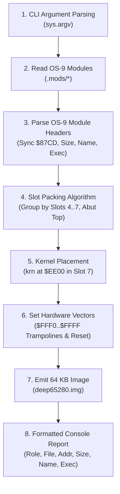
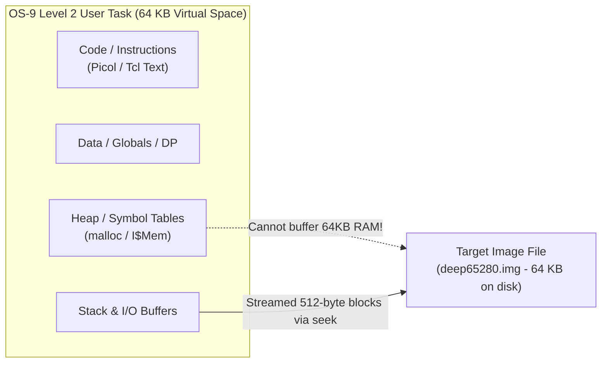
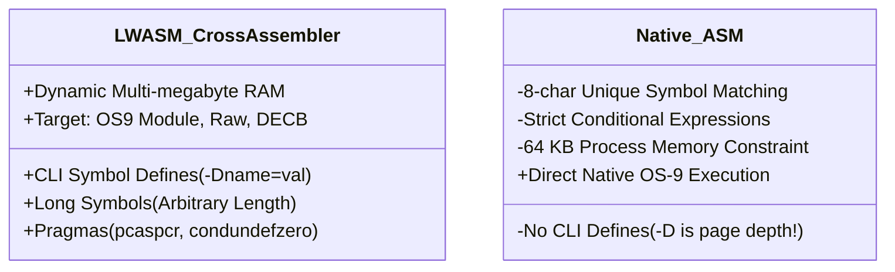
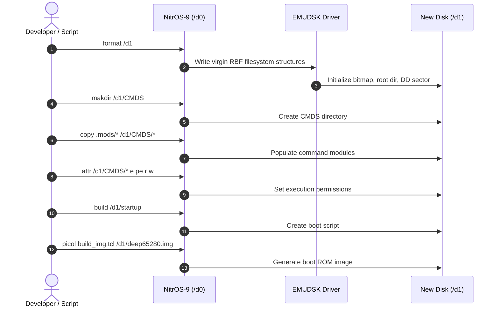
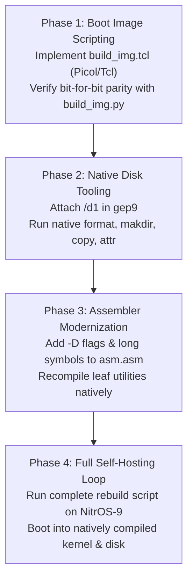

# NitrOS-9 Native Self-Hosting Specification & Feasibility Study

This document investigates the requirements, architectural challenges, and implementation pathway for **regenerating NitrOS-9 entirely on NitrOS-9 itself** (native self-hosting), eliminating build dependencies on host platforms (Linux/macOS), GNU Make, ToolShed, Python 3, and cross-assemblers (`lwasm`).

While this study focuses primarily on the **deep65280** Level 2 platform running on the `gep9` emulator (with 512 KB–2 MB RAM and `EMUDSK` high-speed storage), the design principles and tooling apply equally to other NitrOS-9 targets.

---

## 1. Executive Summary & Goals

### Current Build Dependencies (Cross-Hosted)
Today, building NitrOS-9 requires a modern Unix workstation with:
1. **GNU Make**: Orchestrates the multi-directory dependency graph and module builds.
2. **LWTOOLS (`lwasm`)**: Cross-assembles 6809 and 6309 assembly language files directly into OS-9 module format (`--format=os9`), resolving pragmas and conditional command-line defines (`-D`).
3. **ToolShed (`os9`)**: Provides host-side disk image manipulation (`format`, `makdir`, `copy`, `attr`, `gen`, `padrom`).
4. **Python 3 (`build_img.py`)**: Reads compiled OS-9 binary modules, parses module headers, computes slot packing offsets abutting slot tops, sets top-page hardware vectors (`$FFF0..$FFFF`), and emits the 64 KB memory-mapped boot image (`deep65280.img` or `flat65280.img`).
5. **Bash Scripts (`build_dsk.sh`)**: Directs ToolShed to format, populate, and configure the bootable 10 MB RBF filesystem image (`deep0.dsk`).

### The Self-Hosting Vision
In a fully self-hosted environment:
- **Build Orchestration**: Native OS-9 shell scripts (`sh`) or a native `make` utility drive the build.
- **Assembly**: Native 6809/6309 assembler (`asm`) or a ported `lwasm` runs under OS-9 Level 2.
- **Disk Generation**: Native OS-9 commands (`format`, `makdir`, `copy`, `attr`, `merge`, `cobbler`) create and populate disk filesystems directly on secondary virtual drives (e.g. `/d1`).
- **Image Packing**: A lightweight scripting language—specifically **Tcl 6.7** or an OS-9-enhanced **Picol**—runs natively under OS-9 to parse module headers, pack slots, set hardware vectors, and stream the 64 KB boot image.

---

## 2. Analysis of Python Usage in NitrOS-9 Builds

### Where Python Is Used
Across the entire NitrOS-9 source tree, Python is utilized only in two places during the system build:
- [`recipes/deep65280/build_img.py`](file:///home/strick/modoc/coco-shelf/nitros9/recipes/deep65280/build_img.py): Generates the 64 KB pre-populated ROM/boot image for `deep65280`.
- [`recipes/flat65280/build_img.py`](file:///home/strick/modoc/coco-shelf/nitros9/recipes/flat65280/build_img.py): Generates the sequential boot image for `flat65280`.

*(Other Python scripts in `scripts/` are auxiliary maintenance utilities such as disassemblers, S-record generators, and pre-commit hooks that are not part of the core operating system compilation loop.)*

### Core Functions Performed by `build_img.py`
A line-by-line analysis of [`recipes/deep65280/build_img.py`](file:///home/strick/modoc/coco-shelf/nitros9/recipes/deep65280/build_img.py) reveals eight distinct operations:



1. **CLI Argument Handling**:
   - Accepts the optional destination output image path from `sys.argv[1]`, defaulting to `deep65280.img`.
2. **Binary File Reading**:
   - Opens each compiled module with `open(path, "rb")` and reads the raw binary contents into memory.
3. **OS-9 Module Header Inspection**:
   - **Sync bytes**: Verifies `data[0] == 0x87` and `data[1] == 0xCD`.
   - **Module size**: Reads 16-bit big-endian size: `mod_size = (data[2] << 8) | data[3]`. Verifies `mod_size == len(data)`.
   - **Module name offset**: Reads 16-bit big-endian offset: `name_offset = (data[4] << 8) | data[5]`.
   - **Module name string**: Traverses ASCII bytes starting at `name_offset` until reaching a byte with bit 7 set (`b & 0x80`), masking each byte with `0x7F`.
   - **Execution entry point**: Reads 16-bit big-endian execution offset: `exec_offset = (data[9] << 8) | data[10]`.
4. **Slot Packing Logic**:
   - Modules are assigned to specific MMU physical slot ranges:
     - **Slot 4** (`$8000..$9FFF`): `dir`, `setime`, `date`, `stop`.
     - **Slot 5** (`$A000..$BFFF`): `scf`, `sc6850`, `clock`, `term`, `shell_21`, `mfree`, `free`, `procs`, `mdir`.
     - **Slot 6** (`$C000..$DFFF`): `dd`, `emudsk`, `sysgo`, `rbf`, `ioman`.
     - **Slot 7 lower** (`$E000..$EDFF`): `init`, `krnp2`.
   - **Top-packing calculation**:
     $$\text{total\_slot\_size} = \sum \text{len}(\text{mod})$$
     $$\text{curr\_addr} = \text{slot\_end} - \text{total\_slot\_size}$$
   - **Boundary checks**: Asserts `curr_addr >= slot_start` (ensuring no slot overflow).
   - Sequentially copies each module into the image buffer from `curr_addr` up to `slot_end`.
5. **Kernel Placement**:
   - Places `krn` at fixed address `$EE00` in Slot 7.
   - Asserts `KRN_START_ADDR + len(krn_data) == 0xFF00` (exactly 4,352 bytes).
6. **Top-Page Hardware Vectors (`$FFF0..$FFFF`)**:
   - Writes big-endian 16-bit vector addresses pointing to trampolines in the locked `$FExx` physical page:
     - `$FFF0..$FFF1`: `$FEEE` (Reserved / TRAP)
     - `$FFF2..$FFF3`: `$FEEE` (SWI3)
     - `$FFF4..$FFF5`: `$FEF1` (SWI2)
     - `$FFF6..$FFF7`: `$FEF4` (FIRQ)
     - `$FFF8..$FFF9`: `$FEF7` (IRQ)
     - `$FFFA..$FFFB`: `$FEFA` (SWI)
     - `$FFFC..$FFFD`: `$FEFD` (NMI)
     - `$FFFE..$FFFF`: `krn_exec` (`$EE00 + krn_exec_offset`) (RESET)
7. **Image Output**:
   - Writes the full 65,536-byte raw buffer to disk.
8. **Formatted Terminal Output**:
   - Prints an ASCII table detailing roles, filenames, physical load addresses, byte sizes, module names, and execution offsets.

---

## 3. Scripting Language Requirements & Substitutes

To replace Python on native NitrOS-9, an embedded scripting language must be capable of running under the OS-9 6809 execution environment while fulfilling the functions of `build_img.py`.

The candidate languages considered are:
1. **Tcl 6.7** (John Ousterhout, 1992, adapted for small/embedded systems).
2. **Picol** (Salvatore Sanfilippo, a ~500-1000 line C implementation of Tcl, enhanced for OS-9).

### Core Language Capabilities Required
- File open, seek, read, write, and close.
- Integer arithmetic (16-bit and 32-bit addition, subtraction, bitwise AND/OR/XOR/shift).
- List manipulation (lists of module names and slot assignments).
- Loops (`foreach`, `for`, `while`) and conditionals (`if`/`then`/`else`).
- Formatted console output (`puts`, `format` or simple `printf`).

---

### The NUL Byte ($00) Challenge in Classic Tcl
In classic Tcl (versions prior to Tcl 8.0, including Tcl 6.7 and standard Picol), **all strings are null-terminated C strings (`char *`)**.

> [!CAUTION]
> In 6809/6309 machine code, the byte value `$00` (`NUL`) is extraordinarily common (e.g., `CLRA` is `$4F`, but indexed addressing `0,x` includes `$00`, `LDU #0` contains `$00$00`, and constant tables are full of zeroes). If a script reads binary module code into a standard Tcl string variable:
> ```tcl
> set data [read $f]
> ```
> The Tcl interpreter will truncate the string at the very first `$00` byte, corrupting the module data!

#### Solutions for Binary Data Handling
There are three ways to handle binary data safely in Tcl 6.7 / Picol on OS-9:

#### Strategy A: Streamed File-to-File Copying via `seek` (Recommended)
The scripting language does **not** need to load whole module binaries into Tcl variables. It only needs to inspect the 16-byte header:
1. Read the 16-byte header (which can be read as individual integer byte values via a custom command `read_u16` or `read_bytes`).
2. Calculate the destination offset in `deep65280.img`.
3. Invoke a small binary C shim or OS-9 primitive:
   ```tcl
   # Copy $length bytes from source file to output file at current positions
   bcopy $in_fd $out_fd $length
   ```
4. This keeps all raw binary data in native OS-9 OS I/O buffers without ever passing through the Tcl string parser.

#### Strategy B: Binary I/O Primitives in Enhanced Picol
Because Picol is a compact C codebase (~500 to 1,000 lines), adding binary commands is straightforward:
- `b_read_u16 <chan>`: Reads a 2-byte big-endian integer, returning it as a decimal or hex integer.
- `b_read_name <chan> <offset>`: Seeks to `name_offset`, reads characters until bit 7 is set, and returns a standard clean ASCII string.
- `b_seek_write <out_chan> <target_offset> <src_chan> <length>`: Seeks and copies chunks using a 512-byte C buffer.
- `b_write_u16 <chan> <offset> <value>`: Writes a 2-byte big-endian value directly at `<offset>`.

---

### Memory Constraints: 64 KB Process Virtual Address Space

On OS-9 Level 2, every user process is restricted to a **64 KB virtual address space** (composed of eight 8 KB MMU pages mapped into task memory).



- In Python on a workstation, `bytearray(65536)` allocates 64 KB instantly.
- In OS-9 Level 2, an executing Tcl or Picol process typically occupies 16 KB–32 KB for its code, globals, C runtime, evaluation stack, and string tables. Allocating a second 64 KB contiguous buffer in RAM is **impossible** within a single 64 KB task space!

#### The File Streaming Architecture
Instead of building a 64 KB array in RAM:
1. Create `deep65280.img` on disk and pad/truncate it to 65,536 bytes of `$00`.
2. For each slot group:
   - Read module sizes from their headers.
   - Compute destination offsets.
   - Use `seek` to move the write pointer to the target offset in `deep65280.img`.
   - Stream the module bytes using a small 512-byte transfer buffer.
3. Seek to `$FFF0` and write the 16 bytes of top-page CPU vectors.
4. Total dynamic RAM required by the script: **less than 2 KB**.

---

### Comparison: Tcl 6.7 vs. Enhanced Picol

| Feature | Classic Tcl 6.7 | OS-9 Enhanced Picol |
| :--- | :--- | :--- |
| **Source Code Size** | ~20,000 lines of C | ~600–1,200 lines of C |
| **Compiled Binary Size** | ~45 KB – 60 KB (near limit of 64K task) | ~12 KB – 18 KB |
| **Heap / RAM Overhead** | High (hash tables, extensive parsing trees) | Minimal (flat lists, direct token scanning) |
| **Ease of Adding C Shims** | Moderate (Tcl C API with `Tcl_Interp`) | Trivial (direct dispatch function table) |
| **Execution Speed on 6809** | Moderate (heavy string cloning) | Fast (simple recursive descent) |
| **Recommendation** | Excellent for general-purpose shell scripting | **Best choice for `build_img` and kernel generation** |

---

### Reference Implementation: `build_img.tcl` (Picol / Tcl)

The following script demonstrates how `build_img.py` is implemented cleanly in Tcl/Picol using streamed file I/O:

```tcl
#!/usr/bin/picol
# build_img.tcl - Native NitrOS-9 boot image packer

set IMG_SIZE 65536
set KRN_START 0xEE00
set OUT_FILE "deep65280.img"
if {[llength $argv] > 0} {
    set OUT_FILE [lindex $argv 0]
}

# Define slot groups: {start_addr end_addr {file1 file2 ...}}
set SLOT_GROUPS {
    {0x8000 0xA000 {.mods/dir .mods/setime .mods/date .mods/stop}}
    {0xA000 0xC000 {.mods/scf .mods/sc6850 .mods/clock .mods/term .mods/shell_21 .mods/mfree .mods/free .mods/procs .mods/mdir}}
    {0xC000 0xE000 {.mods/dd .mods/emudsk .mods/sysgo .mods/rbf .mods/ioman}}
    {0xE000 0xEE00 {.mods/init .mods/krnp2}}
}

puts "Initializing $OUT_FILE (64 KB)..."
set out_fp [open $OUT_FILE "w+"]
# Pre-pad image with zeroes
b_pad $out_fp $IMG_SIZE 0

puts [format "%-18s %-12s %-8s %-8s" "File" "Name" "Addr" "Size"]
puts "--------------------------------------------------------"

foreach group $SLOT_GROUPS {
    set slot_start [lindex $group 0]
    set slot_end   [lindex $group 1]
    set mod_list   [lindex $group 2]

    # Pass 1: Compute total size
    set total_size 0
    foreach mod $mod_list {
        set sz [b_mod_size $mod]
        set total_size [expr $total_size + $sz]
    }

    set curr_addr [expr $slot_end - $total_size]
    if {$curr_addr < $slot_start} {
        puts "ERROR: Slot overflow in range $slot_start..$slot_end"
        exit 1
    }

    # Pass 2: Place modules abutting slot top
    foreach mod $mod_list {
        set sz   [b_mod_size $mod]
        set name [b_mod_name $mod]
        puts [format "%-18s %-12s \$%04X   \$%04X" $mod $name $curr_addr $sz]
        
        # Stream copy directly into target image offset
        seek $out_fp $curr_addr
        set in_fp [open $mod "r"]
        b_stream_copy $in_fp $out_fp $sz
        close $in_fp

        set curr_addr [expr $curr_addr + $sz]
    }
}

# Place Kernel at $EE00
set krn_sz   [b_mod_size ".mods/krn"]
set krn_exec [b_mod_exec ".mods/krn"]
puts [format "%-18s %-12s \$%04X   \$%04X" ".mods/krn" "Krn" $KRN_START $krn_sz]
seek $out_fp $KRN_START
set in_fp [open ".mods/krn" "r"]
b_stream_copy $in_fp $out_fp $krn_sz
close $in_fp

# Write Top-Page Hardware Vectors ($FFF0..$FFFF)
seek $out_fp 0xFFF0
b_write_u16 $out_fp 0xFEEE ;# TRAP / Reserved
b_write_u16 $out_fp 0xFEEE ;# SWI3
b_write_u16 $out_fp 0xFEF1 ;# SWI2
b_write_u16 $out_fp 0xFEF4 ;# FIRQ
b_write_u16 $out_fp 0xFEF7 ;# IRQ
b_write_u16 $out_fp 0xFEFA ;# SWI
b_write_u16 $out_fp 0xFEFD ;# NMI
b_write_u16 $out_fp [expr $KRN_START + $krn_exec] ;# RESET

close $out_fp
puts "Image generation complete: $OUT_FILE"
```

---

## 4. Host vs. Native OS-9 Command Matrix

The existing build relies on a variety of host tools and ToolShed utilities. Almost all of these have direct, battle-tested native OS-9 equivalents residing in [`level1/cmds/`](file:///home/strick/modoc/coco-shelf/nitros9/level1/cmds/):

| Host / Makefile Command | ToolShed Command | Native OS-9 Command | Implementation / Notes |
| :--- | :--- | :--- | :--- |
| `make` (GNU Make) | — | `make` / `shell` | Microware `make` exists ([`level2/sys/make.hp`](file:///home/strick/modoc/coco-shelf/nitros9/level2/sys/make.hp)). Alternatively, OS-9 batch shell scripts (`sh script`) handle deterministic builds. |
| `cp <src> <dst>` | `os9 copy -o=0` | `copy <src> <dst>` | [`level1/cmds/copy.asm`](file:///home/strick/modoc/coco-shelf/nitros9/level1/cmds/copy.asm). Native `copy` supports direct file and device duplication. |
| `rm -f <file>` | — | `del <file>` | [`level1/cmds/del.asm`](file:///home/strick/modoc/coco-shelf/nitros9/level1/cmds/del.asm). Deletes files from filesystem. |
| `mkdir -p <dir>` | `os9 makdir <dir>` | `makdir <dir>` | [`level1/cmds/makdir.asm`](file:///home/strick/modoc/coco-shelf/nitros9/level1/cmds/makdir.asm). Creates directory entries. |
| `mv <src> <dst>` | `os9 rename <old> <new>` | `rename <src> <dst>` | [`level1/cmds/rename.asm`](file:///home/strick/modoc/coco-shelf/nitros9/level1/cmds/rename.asm). Renames files in place. |
| `cat <f1> <f2> > <out>` | — | `merge <f1> <f2> > <out>` | [`level1/cmds/merge.asm`](file:///home/strick/modoc/coco-shelf/nitros9/level1/cmds/merge.asm). Concatenates multiple files/modules into one. |
| `chmod` | `os9 attr -q ...` | `attr <file> <perms>` | [`level1/cmds/attr.asm`](file:///home/strick/modoc/coco-shelf/nitros9/level1/cmds/attr.asm). Sets permissions (`e`, `pe`, `w`, `r`, `d`, etc.). |
| `os9 format -e ...` | `os9 format` | `format /d1` | [`level1/cmds/format.asm`](file:///home/strick/modoc/coco-shelf/nitros9/level1/cmds/format.asm). Formats RBF disks natively. |
| `os9 padrom ...` | `os9 padrom` | `padrom <file>` | [`level1/cmds/padrom.asm`](file:///home/strick/modoc/coco-shelf/nitros9/level1/cmds/padrom.asm). Pads module or ROM to specified boundary. |
| `os9 gen ...` | `os9 gen` | `cobbler` / `os9gen` | [`level1/cmds/cobbler.asm`](file:///home/strick/modoc/coco-shelf/nitros9/level1/cmds/cobbler.asm). Generates boot tracks on disk. |
| `os9 ident ...` | `os9 ident` | `ident <mod>` | [`level1/cmds/ident.asm`](file:///home/strick/modoc/coco-shelf/nitros9/level1/cmds/ident.asm). Verifies header parity, CRC, and module metadata. |
| `echo ...` | — | `echo ...` | [`level1/cmds/echo.asm`](file:///home/strick/modoc/coco-shelf/nitros9/level1/cmds/echo.asm). Standard stdout string echo. |
| `touch ...` | — | `touch ...` | [`level1/cmds/touch.asm`](file:///home/strick/modoc/coco-shelf/nitros9/level1/cmds/touch.asm). Updates file modification timestamps. |
| `cmp ...` | — | `cmp ...` | [`level1/cmds/cmp.asm`](file:///home/strick/modoc/coco-shelf/nitros9/level1/cmds/cmp.asm). Binary file comparison. |
| `cat <<EOF > file` | — | `build <file>` | [`level1/cmds/build.asm`](file:///home/strick/modoc/coco-shelf/nitros9/level1/cmds/build.asm). Creates text files from console input. |

---

## 5. The Assembler Gap: `lwasm` vs. Native `asm`

While file manipulation utilities are fully solved by existing native tools, the **assembler** represents the primary technical difference between cross-hosted builds and native builds.

### Comparison: `lwasm` vs. `asm.asm` (v1.11r1)

The native assembler in the repository is [`level1/cmds/asm.asm`](file:///home/strick/modoc/coco-shelf/nitros9/level1/cmds/asm.asm) (Microware ASM with 6309 extensions and enhancements by Curtis Boyle and Rodney Hamilton).



#### Detailed Gap Breakdown:

1. **Command-Line Symbol Definition (`-D`)**:
   - `rules.mak` passes extensive command-line symbols:
     ```makefile
     AFLAGS = -DNOS9VER=$(NOS9VER) -DNOS9MAJ=$(NOS9MAJ) -DNOS9MIN=$(NOS9MIN) -Ddeep65280=1 -DDD=1
     ```
   - In native `asm.asm`: **`-D` sets the page depth of listings (`lines/page`), not symbol definitions!**
   - Native `asm` expects symbols to be defined within the source code or in included definition files (`defsfile`).
   - *Impact*: Native builds cannot pass conditional defines via command-line flags without tool adaptation.

2. **Symbol Name Length**:
   - Native `asm.asm` stores symbols with up to **8 unique characters** (`$0-$7 : 8 char symbol name`).
   - Although lines 28–30 note arbitrary-length labels are read, symbols that share their first 8 characters will clash and be treated as duplicate definitions.
   - NitrOS-9 sources frequently use identifiers longer than 8 characters (e.g. `Sc6850_Inp`, `EMUDSK_Cmd`, `Tk.SmpBlk`, `D.SysMem`).

3. **Pragmas and Conditional Evaluation**:
   - `lwasm` relies on `--pragma=condundefzero` (evaluating undefined symbols in conditional expressions as 0).
   - In native `asm.asm`, evaluating an unassigned symbol in an `IFNE` or `IFEQ` expression causes an assembly error unless explicitly checked via `IFDEF` / `IFNDF`.

4. **Symbol Table Capacity & Memory**:
   - In `lwasm` on a 64-bit PC, the symbol table can hold hundreds of thousands of entries.
   - In `asm.asm` on a 6809, the symbol table lives inside dynamic memory allocated via OS-9 system calls within the process's 64 KB space. Large monolithic files with deep nested inclusions can exhaust the symbol space (Error 207: Symbol Table Full).

---

### Bridging the Assembler Gap

Three viable strategies exist to bridge this gap:

#### Strategy 1: Tcl/Picol Preprocessor for Native `asm`
Before invoking `asm`, a lightweight Picol script:
1. Synthesizes a temporary header file (`build_defs.d`):
   ```assembly
   deep65280 EQU 1
   DD        EQU 1
   DDNum     EQU 0
   NOS9VER   EQU 3
   ```
2. Prepends `use build_defs.d` to the target assembly file.
3. Checks for symbol collisions in the first 8 characters.

#### Strategy 2: Upgrading Native `asm.asm`
Because `asm.asm` source is in-tree ([`level1/cmds/asm.asm`](file:///home/strick/modoc/coco-shelf/nitros9/level1/cmds/asm.asm)):
- Add a new command line switch: `-s<SYM>[=<VAL>]` or modernize option parsing to accept `-D<SYM>=<VAL>`.
- Expand symbol storage from 8 characters to 16 or 32 characters.
- With Level 2 MMU support, `asm` could utilize `F$AllRAM` or alternate memory tasks to page its symbol tables, eliminating memory limits.

#### Strategy 3: Porting `lwasm` to OS-9 Level 2
- `lwasm` is written in standard ANSI C.
- Compiling a stripped-down `lwasm` (targeting `--format=os9` only) using Microware C or gcc6809 would provide 100% source-level compatibility with existing makefiles.

---

## 6. Native Disk Generation & Bootstrapping Architecture

In the cross-development environment, `build_dsk.sh` uses ToolShed's `os9` utility on the host. Under native NitrOS-9, disk generation is performed directly using the OS-9 storage subsystem.

### Multi-Drive Setup on `deep65280` (`gep9`)
The `deep65280` architecture supports multiple virtual drives via `EMUDSK`. In `defs/deep65280.d`:
- `/d0` (`/DD`): Drive 0 (The running system root disk, e.g. `deep0.dsk`).
- `/d1`: Drive 1 (Target scratch/regeneration disk, e.g. `new_deep0.dsk`).



### Native Disk Build Script: `build_dsk.sh` (OS-9 Shell)
The entire `build_dsk.sh` translates into a native OS-9 shell script:

```bash
* Native NitrOS-9 Disk Regeneration Script
echo "Formatting target drive /d1..."
format /d1 -e -n"DEEP65280"

echo "Creating CMDS directory..."
makdir /d1/CMDS

echo "Copying Level 2 commands..."
copy .mods/asm     /d1/CMDS/asm
copy .mods/copy    /d1/CMDS/copy
copy .mods/dir     /d1/CMDS/dir
copy .mods/mdir    /d1/CMDS/mdir
copy .mods/free    /d1/CMDS/free
copy .mods/mfree   /d1/CMDS/mfree
copy .mods/procs   /d1/CMDS/procs
copy .mods/shell_21 /d1/CMDS/shell_21
copy .mods/shell_21 /d1/CMDS/shell
copy .mods/format  /d1/CMDS/format
copy .mods/makdir  /d1/CMDS/makdir
copy .mods/attr    /d1/CMDS/attr
copy .mods/del     /d1/CMDS/del
copy .mods/rename  /d1/CMDS/rename
copy .mods/merge   /d1/CMDS/merge
copy .mods/ident   /d1/CMDS/ident
copy .mods/date    /d1/CMDS/date
copy .mods/setime  /d1/CMDS/setime
copy .mods/stop    /d1/CMDS/stop
copy .mods/tmode   /d1/CMDS/tmode

echo "Setting permissions..."
attr /d1/CMDS/* e pe r w

echo "Generating startup script..."
build /d1/startup
tmode pau=0 </2
setime 2001/01/01

attr /d1/startup r w
echo "Target disk /d1 populated successfully."
```

---

## 7. Phased Implementation Roadmap

To achieve native self-hosting methodically without breaking working environments, a four-phase rollout is recommended:



### Phase 1: Boot Image Scripting (`build_img.tcl`)
- **Action**: Implement `build_img.tcl` using Picol and small binary C shims (`b_mod_size`, `b_stream_copy`, `b_write_u16`).
- **Verification**: Run `build_img.tcl` on both Linux and under NitrOS-9 inside `gep9`. Compare the output binary against `build_img.py` using `cmp`.
- **Success Criteria**: Bit-for-bit identical 65,536-byte `deep65280.img`.

### Phase 2: Native Disk Generation
- **Action**: Add secondary drive descriptor `/d1` to the `deep65280` image recipe.
- **Verification**: Boot NitrOS-9 in `gep9`, format `/d1`, populate it with commands using native `copy` and `attr`, and inspect using native `dir /d1` and `mdir`.
- **Success Criteria**: A fully functioning RBF disk created entirely within the virtual machine.

### Phase 3: Assembler Modernization & Leaf Recompilation
- **Action**: 
  - Enhance [`level1/cmds/asm.asm`](file:///home/strick/modoc/coco-shelf/nitros9/level1/cmds/asm.asm) with `-D<SYM>[=<VAL>]` definition parsing.
  - Expand symbol table comparison to 16 characters.
- **Verification**: Assemble individual utility commands natively:
  ```bash
  asm date.asm -o=/d1/CMDS/date
  asm free.asm -o=/d1/CMDS/free
  ```
  Verify execution of natively compiled binaries.
- **Success Criteria**: Natively assembled utilities execute identically to cross-assembled binaries.

### Phase 4: Full System Regeneration ("The Self-Hosting Circle")
- **Action**: Assemble all kernel modules (`krn`, `krnp2`, `ioman`, `init`, drivers, and descriptors) on `/d0`.
- **Action**: Run `build_img.tcl` to generate `new_kernel.img`.
- **Action**: Format and populate `/d1`.
- **Action**: Point `gep9` to boot from `new_kernel.img` and `/d1`.
- **Success Criteria**: NitrOS-9 boots successfully into an operating system and userland built 100% by itself.

---

## 8. Conclusion & Recommendations

1. **Python Elimination**: Replacing Python is straightforward. `build_img.py` performs no complex math or dependencies; its logic maps directly to **Picol** or **Tcl 6.7** when structured using streamed file copying (`seek` + `bcopy`) to respect the 64 KB process memory limits of OS-9 Level 2.
2. **File & Disk Tooling**: The NitrOS-9 codebase already possesses complete native equivalents for every ToolShed and Unix file utility (`copy`, `del`, `makdir`, `merge`, `attr`, `format`, `padrom`, `cobbler`).
3. **Primary Investment Area**: The only substantial engineering effort required for full self-hosting is the **assembler**—specifically adding command-line symbol definitions (`-D`) and expanding symbol name length in `asm.asm` (or porting a focused subset of `lwasm`).

With 512 KB–2 MB of physical RAM and high-speed `EMUDSK` block storage, `deep65280` on `gep9` provides an ideal platform to realize complete, native self-hosting for NitrOS-9.
