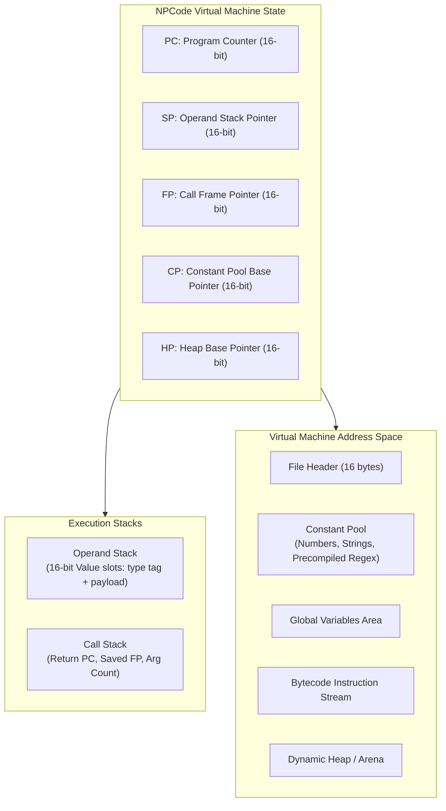

# NP Language & NPCode Virtual Machine Specification

**Version:** 0.1 (Draft)  
**Date:** October 2026  
**Document:** `npcode/design.md`  
**Source Language:** NP (`*.np`)  
**Bytecode Target:** NPCode (`*.npc`)  
**Virtual Machine Interpreter:** `npcode`  

---

## 1. Introduction & Design Philosophy

The **NP** language and **NPCode** Virtual Machine are designed to provide a lightweight, deterministic, and easily portable programming environment tailored for 8-bit and 16-bit platforms—specifically Motorola 6809 and Hitachi 6309 systems running NitrOS-9 Level 1 and Level 2, as well as embedded microcontrollers (RP2350) and Unix hosts.

The primary motivating workload is the native self-generation and source transformation pipeline for NitrOS-9 (e.g. [`recipes/deep65280/selfgen_preprocess.py`](file:///home/strick/modoc/coco-shelf/nitros9/recipes/deep65280/selfgen_preprocess.py)), which translates modern assembly source into native assembler dialects. While Python 3 is rich and expressive, running full Python on an 8-bit / 16-bit microprocessor with a 64 KB address space is impractical.

### 1.1 Core Directives & Deliberate Simplifications

To ensure the interpreter can be implemented in fewer than 1,500 lines of standard C (or ~3,000 instructions in 6809 assembly) and run inside a **32 KB–64 KB memory footprint**, NP deliberately omits complex Python runtime features:

| Complex Feature in Python | NP Alternative / Workaround | Rationale |
| :--- | :--- | :--- |
| **Closures & Nested Scopes** | Static / top-level functions with explicit context parameters or module-level state. | Eliminates stack frame heap-promotion, cell objects, and variable dereference chains. |
| **Exception Handling (`try/except/finally`)** | Explicit status return codes / multiple return values (e.g., `val, ok = parse_int(s)`). | Eliminates unwinding tables, exception frame stacks, and dynamic error dispatch. |
| **RAII / Context Managers (`with`)** | Explicit resource management (`f = open(...); ...; f.close()`). | Avoids hidden function calls (`__enter__`, `__exit__`) and unwind cleanup blocks. |
| **Lookaround Regex (`(?<!...)`, `(?!...)`)** | Dedicated identifier-boundary scanner primitive: `replace_ident(s, old, new)`. | Eliminates 90% of backtracking regex engine complexity; allows linear $O(N)$ string scanning. |
| **Arbitrary-Precision BigInts** | Fixed-width 16-bit signed integers and 32-bit words. | Simple single-cycle or small math routines on 6809/6309. |
| **Dynamic Multi-Inheritance & Metaclasses** | Simple typed structures / records (`struct`) with named fields. | Fast constant offset indexing (`field_offset`); no dynamic method resolution tables. |
| **Garbage Collection (Generational / Tracing)** | Bump-pointer allocation with per-pass/per-line arena reset, plus reference counting for long-lived objects. | Prevents latency spikes and runs efficiently within a 64 KB process memory space. |

---

## 2. The NP Source Language (`*.np`)

NP features a Python-like, readable syntax with indentation-based blocking or optional braces, static function bindings, explicit error handling, and built-in text processing primitives.

### 2.1 Type System

NP supports a small, orthogonal set of primitive and composite types:

1. **`nil`**: Null/none value.
2. **`bool`**: `true` or `false`.
3. **`int`**: 16-bit signed integer ($-32,768 \dots +32,767$).
4. **`int32`**: 32-bit signed integer (for byte offsets and large fill counts).
5. **`str`**: Immutable sequence of UTF-8/ASCII bytes. Slices produce lightweight views (`string_view`) referencing parent memory without allocation.
6. **`list`**: Dynamic array of values (`[a, b, c]`).
7. **`dict`**: Hash table of string keys to arbitrary values (`{k: v}`).
8. **`set`**: Hash set of unique strings (`{"A", "B"}`).
9. **`struct`**: Named record with fixed fields (`struct PreprocessorContext { id: int }`).
10. **`file`**: System I/O file handle.

### 2.2 Control Flow

- **Conditionals**: `if cond: ... elif cond: ... else: ...`
- **Loops**:
  - `while cond: ...`
  - `for item in list: ...`
  - `for key, val in dict: ...`
  - `break` and `continue`
- **Function Definitions**:
  ```python
  fn split_asm_line(line: str) -> (str, str):
      let s = line.rstrip("\r\n")
      let s_strip = s.lstrip()
      if s == "" or s_strip.startswith("*") or s_strip.startswith(";"):
          return ("", line)
      # ...
      return (code_part, comment_part)
  ```
- **Error Handling by Convention**:
  ```python
  # Instead of try...except ValueError on int(count):
  let val, ok = parse_int(count)
  if ok:
      # use numeric val
  else:
      # handle symbolic count
  ```

---

## 3. NPCode Virtual Machine Architecture

NPCode is a **stack-based virtual machine** with explicit operand and call stacks, optimized for fast decoding on 8-bit and 16-bit microprocessors.



### 3.1 Stack and Value Representation

Every slot on the operand stack is a **4-byte tagged union (`Value`)**, fitting cleanly into two 16-bit CPU registers (e.g. `U` and `Y` on the 6809):

```text
Byte:     0       1       2       3
      +-------+-------+-------+-------+
      |  Tag  | Flags |    Payload    |
      +-------+-------+-------+-------+
```

- **`Tag` (8 bits)**:
  - `0x00`: `VAL_NIL`
  - `0x01`: `VAL_BOOL` (Payload = 0 or 1)
  - `0x02`: `VAL_INT` (Payload = 16-bit signed integer)
  - `0x03`: `VAL_INT32` (Payload = heap pointer to 32-bit int)
  - `0x04`: `VAL_STR` (Payload = pointer to `String` descriptor)
  - `0x05`: `VAL_LIST` (Payload = pointer to `List` header)
  - `0x06`: `VAL_DICT` (Payload = pointer to `Dict` header)
  - `0x07`: `VAL_SET` (Payload = pointer to `Set` header)
  - `0x08`: `VAL_STRUCT` (Payload = pointer to `Struct` header)
  - `0x09`: `VAL_FILE` (Payload = file descriptor ID)
- **`Flags` (8 bits)**: Memory management flags (arena allocated, constant, ref count bits).
- **`Payload` (16 bits)**: Direct 16-bit value or pointer into memory.

### 3.2 Call Frame Structure

When a function is called (`CALL`), the call stack records:
1. `Return PC` (16 bits): Instruction pointer of the caller.
2. `Old FP` (16 bits): Frame pointer of the caller.
3. `Arg Count` (8 bits): Number of arguments passed.

Local variables and function parameters are indexed relative to `FP`:
- `FP[0] .. FP[N-1]`: Function parameters (pushed by caller).
- `FP[N] .. FP[N+M-1]`: Local variables (initialized to `nil`).

---

## 4. Binary File Format (`*.npc`)

NPCode binary files are compiled, self-contained bytecode executables with the extension `.npc`. All multi-byte values are encoded in **Big-Endian** (most significant byte first), matching the native byte order of the 6809 and 6309 CPUs.

### 4.1 File Layout

```text
+-----------------------------------------------------------+
| 1. Header (16 bytes)                                      |
+-----------------------------------------------------------+
| 2. Constant Pool (Variable length)                        |
+-----------------------------------------------------------+
| 3. Global Variable Descriptors (Variable length)          |
+-----------------------------------------------------------+
| 4. Function Table (Variable length)                       |
+-----------------------------------------------------------+
| 5. Bytecode Section (Variable length)                     |
+-----------------------------------------------------------+
```

### 4.2 Header Specification (16 Bytes)

| Offset | Size | Field Name | Description |
| :--- | :--- | :--- | :--- |
| `0x00` | 4 | `Magic` | Byte sequence `0x4E 0x50 0x43 0x01` (`"NPC\x01"`) |
| `0x04` | 1 | `FormatVer` | Format version (currently `1`) |
| `0x05` | 1 | `Flags` | Flags: Bit 0 = Requires 6309, Bit 1 = OS-9 Level 2 MMU banked |
| `0x06` | 2 | `ConstCount` | Number of entries in the Constant Pool |
| `0x08` | 2 | `GlobalsCount`| Number of global variable slots to reserve |
| `0x0A` | 2 | `FuncCount` | Number of functions in the Function Table |
| `0x0C` | 2 | `EntryFunc` | Function index of the entry point (`main`) |
| `0x0E` | 2 | `CodeSize` | Total size of the Bytecode Section in bytes |

### 4.3 Constant Pool Format

Each entry in the constant pool begins with a 1-byte type tag:

- **Integer Constant (`0x02`)**:
  - `Tag` (1 byte = `0x02`)
  - `Value` (2 bytes = `int16_t`)
- **Int32 Constant (`0x03`)**:
  - `Tag` (1 byte = `0x03`)
  - `Value` (4 bytes = `int32_t`)
- **String Constant (`0x04`)**:
  - `Tag` (1 byte = `0x04`)
  - `Length` (2 bytes = `uint16_t`)
  - `Bytes` (`Length` bytes, null-terminated for C string interop)
- **Regex Descriptor Constant (`0x0A`)**:
  - `Tag` (1 byte = `0x0A`)
  - `OpcodeCount` (2 bytes)
  - `Bytecode` (Precompiled regex NFA instructions)

### 4.4 Function Table Format

Describes every callable function in the binary:
- `ArgCount` (1 byte): Number of positional arguments expected.
- `LocalCount` (1 byte): Number of local variables allocated on entry.
- `CodeOffset` (2 bytes): Offset into the Bytecode Section where code begins.

---

## 5. Instruction Set Architecture (ISA)

Instructions in NPCode consist of a **1-byte Opcode** optionally followed by immediate operands.

### 5.1 Immediate Operand Formats
- `<imm8>`: 1-byte unsigned index / integer.
- `<imm16>`: 2-byte big-endian unsigned index / offset.
- `<rel16>`: 2-byte signed branch offset relative to the next instruction.

---

### 5.2 Complete Opcode Table

#### Category 1: Stack & Literal Operations (`0x00 .. 0x0F`)

| Opcode | Mnemonic | Operands | Stack Effect | Description |
| :--- | :--- | :--- | :--- | :--- |
| `0x00` | `NOP` | None | `[] -> []` | No operation. |
| `0x01` | `PUSH_NIL` | None | `[] -> [nil]` | Push `nil` onto operand stack. |
| `0x02` | `PUSH_TRUE` | None | `[] -> [true]` | Push Boolean `true`. |
| `0x03` | `PUSH_FALSE` | None | `[] -> [false]`| Push Boolean `false`. |
| `0x04` | `PUSH_ZERO` | None | `[] -> [0]` | Fast push of integer `0`. |
| `0x05` | `PUSH_ONE` | None | `[] -> [1]` | Fast push of integer `1`. |
| `0x06` | `PUSH_I8` | `<imm8>` | `[] -> [val]` | Push sign-extended 8-bit immediate integer. |
| `0x07` | `PUSH_CONST` | `<imm16>` | `[] -> [val]` | Push constant from Constant Pool at index. |
| `0x08` | `POP` | None | `[a] -> []` | Discard top of stack. |
| `0x09` | `DUP` | None | `[a] -> [a, a]`| Duplicate top element. |
| `0x0A` | `SWAP` | None | `[a, b] -> [b, a]`| Swap top two elements. |

#### Category 2: Local & Global Variables (`0x10 .. 0x1F`)

| Opcode | Mnemonic | Operands | Stack Effect | Description |
| :--- | :--- | :--- | :--- | :--- |
| `0x10` | `LOAD_LOCAL` | `<imm8>` | `[] -> [val]` | Push local variable `FP[imm8]`. |
| `0x11` | `STORE_LOCAL`| `<imm8>` | `[val] -> []` | Pop and store into `FP[imm8]`. |
| `0x12` | `LOAD_GLOBAL` | `<imm16>` | `[] -> [val]` | Push global variable `Globals[imm16]`. |
| `0x13` | `STORE_GLOBAL`| `<imm16>` | `[val] -> []` | Pop and store into `Globals[imm16]`. |
| `0x14` | `LOAD_FIELD` | `<imm8>` | `[obj] -> [val]`| Load struct field at offset `imm8`. |
| `0x15` | `STORE_FIELD`| `<imm8>` | `[obj, val] -> []`| Store value into struct field at offset `imm8`. |
| `0x16` | `LOAD_INDEX` | None | `[coll, key] -> [val]`| Subscript load: `coll[key]`. |
| `0x17` | `STORE_INDEX`| None | `[coll, key, val] -> []`| Subscript store: `coll[key] = val`. |

#### Category 3: Arithmetic, Logic & Comparisons (`0x20 .. 0x3F`)

| Opcode | Mnemonic | Operands | Stack Effect | Description |
| :--- | :--- | :--- | :--- | :--- |
| `0x20` | `ADD` | None | `[a, b] -> [a + b]` | Integer addition or string concatenation. |
| `0x21` | `SUB` | None | `[a, b] -> [a - b]` | Integer subtraction. |
| `0x22` | `MUL` | None | `[a, b] -> [a * b]` | Integer multiplication or list repetition. |
| `0x23` | `DIV` | None | `[a, b] -> [a / b]` | Integer division (truncated towards zero). |
| `0x24` | `MOD` | None | `[a, b] -> [a % b]` | Integer modulo. |
| `0x25` | `NEG` | None | `[a] -> [-a]` | Arithmetic negation. |
| `0x26` | `BIT_AND` | None | `[a, b] -> [a & b]` | Bitwise AND. |
| `0x27` | `BIT_OR` | None | `[a, b] -> [a \| b]` | Bitwise OR. |
| `0x28` | `BIT_XOR` | None | `[a, b] -> [a ^ b]` | Bitwise XOR. |
| `0x29` | `BIT_NOT` | None | `[a] -> [~a]` | Bitwise inversion. |
| `0x2A` | `SHL` | None | `[a, b] -> [a << b]`| Shift left. |
| `0x2B` | `SHR` | None | `[a, b] -> [a >> b]`| Arithmetic shift right. |
| `0x2C` | `CMP_EQ` | None | `[a, b] -> [bool]` | Equal (`==`). Supports int, str, nil. |
| `0x2D` | `CMP_NE` | None | `[a, b] -> [bool]` | Not equal (`!=`). |
| `0x2E` | `CMP_LT` | None | `[a, b] -> [bool]` | Less than (`<`). |
| `0x2F` | `CMP_LE` | None | `[a, b] -> [bool]` | Less than or equal (`<=`). |
| `0x30` | `CMP_GT` | None | `[a, b] -> [bool]` | Greater than (`>`). |
| `0x31` | `CMP_GE` | None | `[a, b] -> [bool]` | Greater than or equal (`>=`). |
| `0x32` | `NOT` | None | `[a] -> [bool]` | Logical NOT. |
| `0x33` | `MIN` | None | `[a, b] -> [min(a,b)]`| Integer minimum. |
| `0x34` | `MAX` | None | `[a, b] -> [max(a,b)]`| Integer maximum. |
| `0x35` | `PARSE_INT`| None | `[str, radix] -> [val, ok]`| Radix string parser (radix 0 = autodetect). Pushes parsed integer and Boolean status. |

#### Category 4: Control Flow & Functions (`0x40 .. 0x4F`)

| Opcode | Mnemonic | Operands | Stack Effect | Description |
| :--- | :--- | :--- | :--- | :--- |
| `0x40` | `JUMP` | `<rel16>` | `[] -> []` | Unconditional relative branch. |
| `0x41` | `JUMP_IF_TRUE`| `<rel16>`| `[cond] -> []` | Branch if `cond` is truthy (pops `cond`). |
| `0x42` | `JUMP_IF_FALSE`| `<rel16>`| `[cond] -> []`| Branch if `cond` is falsey (pops `cond`). |
| `0x43` | `CALL` | `<imm16>, <imm8>` | `[args...] -> [res]` | Call function at table index `imm16` with `imm8` arguments. |
| `0x44` | `RET` | None | `[res] -> [...]` | Return top of stack to caller frame. |
| `0x45` | `RET_VOID` | None | `[] -> [...]` | Return `nil` to caller frame. |
| `0x46` | `HALT` | None | `[] -> []` | Halt VM execution cleanly (exit 0). |

#### Category 5: String & Text Processing (`0x50 .. 0x6F`)

| Opcode | Mnemonic | Operands | Stack Effect | Description |
| :--- | :--- | :--- | :--- | :--- |
| `0x50` | `STR_LEN` | None | `[str] -> [len]` | Length of string in bytes. |
| `0x51` | `STR_SLICE` | None | `[str, start, end] -> [slice]`| Substring view without copying memory. |
| `0x52` | `STR_CHAR_AT`| None | `[str, idx] -> [char_code]`| Returns byte value at index. |
| `0x53` | `STR_LSTRIP` | None | `[str, chars] -> [view]`| Strip leading characters in `chars` (`nil` = whitespace). |
| `0x54` | `STR_RSTRIP` | None | `[str, chars] -> [view]`| Strip trailing characters in `chars`. |
| `0x55` | `STR_STRIP` | None | `[str, chars] -> [view]`| Strip leading and trailing characters. |
| `0x56` | `STR_UPPER` | None | `[str] -> [new_str]` | Returns uppercase ASCII copy. |
| `0x57` | `STR_FIND` | None | `[str, sub, start] -> [idx]`| Linear search; returns index or -1. |
| `0x58` | `STR_STARTSWITH`| None | `[str, prefix] -> [bool]`| Prefix check. |
| `0x59` | `STR_ENDSWITH`| None | `[str, suffix] -> [bool]`| Suffix check. |
| `0x5A` | `STR_REPLACE` | None | `[str, old, new] -> [res]`| Global substring replacement. |
| `0x5B` | `STR_SPLITLINES`| None | `[str] -> [list]` | Splits text by `\n` or `\r\n` into a list of line views. |
| `0x5C` | `STR_JOIN` | None | `[delim, list] -> [str]`| Joins list of strings using delimiter. |
| `0x5D` | `STR_FORMAT_INT`| `<imm8>`| `[val] -> [str]`| Formats integer with width and zero-padding (e.g. `%04d` or `%05d`). |
| `0x5E` | `STR_ISSPACE` | None | `[str] -> [bool]` | True if string contains only whitespace or is empty. |
| `0x5F` | `STR_REPLACE_IDENT`| None | `[str, old, new] -> [res]`| **Identifier-Boundary Replacer**: Replaces `old` with `new` only when not preceded or followed by `[A-Za-z0-9_.]`. (Replaces lookahead/lookbehind regex!). |

#### Category 6: Collections: Lists, Dicts & Sets (`0x70 .. 0x8F`)

| Opcode | Mnemonic | Operands | Stack Effect | Description |
| :--- | :--- | :--- | :--- | :--- |
| `0x70` | `LIST_NEW` | `<imm16>` | `[] -> [list]` | Create list preallocated with capacity `imm16`. |
| `0x71` | `LIST_APPEND`| None | `[list, val] -> []`| Append element to list. |
| `0x72` | `LIST_LEN` | None | `[list] -> [len]` | Return count of elements. |
| `0x73` | `LIST_POP` | None | `[list] -> [val]` | Pop and return last element. |
| `0x74` | `LIST_INDEX_OF`| None | `[list, val] -> [idx, ok]`| Search for value in list; pushes index and Boolean. |
| `0x75` | `LIST_REMOVE_AT`| None | `[list, idx] -> []`| Remove element at index, shifting tail left. |
| `0x76` | `LIST_SORT_BY_LEN`| None | `[list, reverse] -> []`| Sorts list of strings by length (in-place). |
| `0x77` | `DICT_NEW` | `<imm16>` | `[] -> [dict]` | Create hash table with bucket capacity. |
| `0x78` | `DICT_GET` | None | `[dict, key] -> [val, ok]`| Lookup key; pushes value and found flag. |
| `0x79` | `DICT_SET` | None | `[dict, key, val] -> []`| Insert or update key-value pair. |
| `0x7A` | `DICT_HAS` | None | `[dict, key] -> [bool]`| Membership test. |
| `0x7B` | `DICT_KEYS` | None | `[dict] -> [list]` | Returns list of string keys. |
| `0x7C` | `DICT_ITEMS` | None | `[dict] -> [list_of_pairs]`| Returns list of `(key, value)` pairs. |
| `0x7D` | `SET_NEW` | `<imm16>` | `[] -> [set]` | Create string hash set. |
| `0x7E` | `SET_ADD` | None | `[set, str] -> []` | Add string to set. |
| `0x7F` | `SET_HAS` | None | `[set, str] -> [bool]` | Test if string exists in set. |

#### Category 7: Regular Expressions (`0x90 .. 0x9F`)

NPCode supports a small, efficient non-backtracking NFA regex engine. All complex lookarounds are offloaded to Category 5 opcodes (`STR_REPLACE_IDENT`).

| Opcode | Mnemonic | Operands | Stack Effect | Description |
| :--- | :--- | :--- | :--- | :--- |
| `0x90` | `REG_MATCH` | `<imm16>` | `[str] -> [match, ok]`| Match string against precompiled regex at index `imm16` anchored at start. |
| `0x91` | `REG_SEARCH`| `<imm16>` | `[str] -> [match, ok]`| Unanchored search in string. |
| `0x92` | `REG_GROUP` | None | `[match, grp_idx] -> [str]`| Extract captured group string. |
| `0x93` | `REG_GROUP_END`| None | `[match, grp_idx] -> [pos]`| Return ending character index of capture. |
| `0x94` | `REG_SUB` | `<imm16>` | `[str, repl] -> [res]`| Replace all regex matches with constant string `repl`. |

#### Category 8: File System & OS System Calls (`0xA0 .. 0xAF`)

Directly map to OS-9 I/O calls (`I$Open`, `I$Create`, `I$ReadLn`, `I$Write`, `I$Close`).

| Opcode | Mnemonic | Operands | Stack Effect | Description |
| :--- | :--- | :--- | :--- | :--- |
| `0xA0` | `FILE_OPEN_READ`| None | `[path] -> [handle, ok]`| Open file for reading (`I$Open`). |
| `0xA1` | `FILE_OPEN_WRITE`| None | `[path] -> [handle, ok]`| Create/truncate file for writing (`I$Create`). |
| `0xA2` | `FILE_READLINE` | None | `[handle] -> [line, eof]`| Read line via `I$ReadLn`. |
| `0xA3` | `FILE_WRITE` | None | `[handle, str] -> [ok]` | Write string buffer via `I$Write`. |
| `0xA4` | `FILE_CLOSE` | None | `[handle] -> []` | Close path via `I$Close`. |
| `0xA5` | `OS_ISFILE` | None | `[path] -> [bool]` | Test file existence. |
| `0xA6` | `OS_MAKEDIRS` | None | `[path] -> [ok]` | Recursively create directories (`I$MakDir`). |
| `0xA7` | `SYS_ARGS` | None | `[] -> [list]` | Push command line arguments. |
| `0xA8` | `SYS_EXIT` | None | `[code] -> []` | Exit process with status code (`F$Exit`). |
| `0xA9` | `IO_PRINT` | None | `[str] -> []` | Print string followed by newline to stdout (`I$WriteLn`). |

---

## 6. Mapping `selfgen_preprocess.py` to NP / NPCode

Below are concrete examples demonstrating how Python patterns in `selfgen_preprocess.py` map directly to NP without requiring closures, exceptions, RAII, or lookaround assertions.

### 6.1 Replacing Exceptions: Numeric Parsing

In Python:
```python
try:
    c = int(count, 0)
    # numeric expansion loop...
except ValueError:
    # symbolic fill...
```

In NP:
```python
let c, ok = parse_int(count, 0)
if ok:
    # numeric expansion loop:
    out.append(lbl_part + "* PREPROCESSED FILL: " + val + ", " + count)
    while c > 0:
        let chunk = min(c, 16)
        out.append(indent + " fcb " + make_comma_list(val, chunk))
        c = c - chunk
else:
    # symbolic fill fallback:
    if lbl_part != "":
        out.append(lbl_part + "equ *")
    out.append("* [selfgen: symbolic fill skipped in asm]")
```

### 6.2 Replacing Closures: Local Label Substitution

In Python, `re.sub(r'([A-Za-z0-9_.]+?)@', repl_local, code_part)` relied on an inner closure capturing `local_map` and `self`.

In NP, we eliminate the closure by using a straightforward scanning loop and passing the context structure explicitly:

```python
struct LocalLabelScope:
    map: dict          # label name -> resolved string
    next_id: int       # counter

fn resolve_local_label(scope: LocalLabelScope, name: str) -> str:
    let clean_name = name.replace(".", "_")
    let existing, ok = scope.map.get(name)
    if ok:
        return existing
    scope.next_id = scope.next_id + 1
    let new_lbl = "L" + format_int(scope.next_id, 4) + clean_name.slice(0, 2)
    scope.map.set(name, new_lbl)
    return new_lbl

fn replace_all_locals(scope: LocalLabelScope, code: str) -> str:
    # Scans for identifier followed by '@' and replaces using resolve_local_label
    # Deterministic linear scan; no closure required.
```

### 6.3 Replacing Lookaround Regex: Symbol Collision Replacement

In Python:
```python
pat = r"(?<![A-Za-z0-9_.])" + re.escape(old_sym) + r"(?![A-Za-z0-9_.])"
code_part = re.sub(pat, new_sym, code_part)
```

In NPCode:
The VM provides the dedicated opcode `STR_REPLACE_IDENT`:
```python
code_part = code_part.replace_ident(old_sym, new_sym)
```
**VM Implementation**:
The VM iterates through `code_part`. When `old_sym` matches:
1. It inspects the character immediately before the match: if it is alphanumeric, `_`, or `.`, the match is rejected.
2. It inspects the character immediately after the match: if it is alphanumeric, `_`, or `.`, the match is rejected.
3. Otherwise, the substitution is performed.
This executes in $O(N)$ single-pass time and requires zero regex engine states.

---

## 7. Memory Budget & Execution Model on NitrOS-9

### 7.1 Memory Layout inside a 64 KB OS-9 Process

On NitrOS-9 Level 2 (`deep65280`), a standard process has a 64 KB memory space:

```text
$0000 +-----------------------------------------------------------+
      | Direct Page & OS-9 System Globals (256 bytes)             |
$0100 +-----------------------------------------------------------+
      | npcode VM Engine Machine Code (~10-12 KB)                 |
$3000 +-----------------------------------------------------------+
      | Loaded Bytecode (.npc) + Constant Pool (~8 KB)            |
$5000 +-----------------------------------------------------------+
      | Dynamic Heap: String Views, Dicts, Hash Tables (~32 KB)   |
$D000 +-----------------------------------------------------------+
      | Operand Stack (2 KB)                                      |
$D800 +-----------------------------------------------------------+
      | Call Stack & Frame Descriptors (2 KB)                     |
$E000 +-----------------------------------------------------------+
      | Hardware I/O / OS-9 MMU Boundary                          |
+-----------------------------------------------------------+
```

### 7.2 Line-by-Line Streaming Guarantee

By avoiding Python's `read()` and `splitlines()` full-buffer allocations, NP programs operate as **streaming filters**:
1. Read input line into a single 128-byte reusable buffer (`FILE_READLINE`).
2. Execute preprocessing transformations.
3. Write transformed line directly to output file (`FILE_WRITE`).
4. Reset the per-line allocation arena pointer (`HP`).

This guarantees that memory usage remains constant ($< 16\text{ KB}$ heap usage) regardless of whether the source file being processed is 100 lines or 100,000 lines.

---

## 8. Development Roadmap

1. **Phase 1: Host-based Prototype Compiler & Disassembler**:
   - Python-based reference compiler (`npc.py`) translating `*.np` source into `*.npc` bytecode binaries.
   - Command-line disassembler (`npcdump`) to inspect constant pools and opcode streams.
2. **Phase 2: ANSI C Reference Interpreter (`npcode`)**:
   - Portable, zero-dependency C implementation of the VM loop.
   - Verify 100% test-suite parity running the preprocessor against all NitrOS-9 modules (`scf.asm`, `rbf.asm`, `init.asm`).
3. **Phase 3: Native 6809/6309 Port**:
   - Assemble `npcode` natively using `lwasm` / `asm`.
   - Incorporate into NitrOS-9 Level 2 `/dd/CMDS/npcode`.
   - Run native NitrOS-9 self-generation completely free of host Python!
