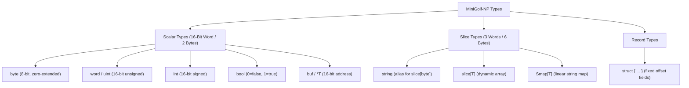

# MiniGolf-NP Formal Language & Compilation Specification

**Language Name:** MiniGolf-NP (NP Source Language)  
**Target Architecture:** NPCode Virtual Machine (`*.npc`) / NP Assembly (`*.npasm`)  
**Specification Version:** 1.0  
**Date:** October 2026  
**Document:** `npcode/minigolf_spec.md`  
**Reference Implementations:**  
- MiniGolf Language Reference: `/home/strick/github.com/strickyak/minigolf/doc/minigolf_lang.md`  
- MiniGolf AST: `/home/strick/github.com/strickyak/minigolf/ast/ast.go`  
- Runtime Libraries: `/home/strick/github.com/strickyak/minigolf/golflib/prelude.golf`, `smap.golf`  
- Bytecode ISA: `npcode/design.md`, `npcode/opcodes.py`  
- Assembler / Disassembler / Emulator: `npcode/npasm.py`, `npcode/npdis.py`, `npcode/npvm.py`  

---

## 1. Introduction & Objectives

**MiniGolf-NP** is an intentional, strictly defined subset of the MiniGolf programming language tailored specifically as the high-level systems source language for the **NPCode Virtual Machine** and 6809/6309 NitrOS-9 environments.

### 1.1 Core Directives
1. **Strict Subset of Go Syntax**: Every valid MiniGolf-NP program is valid Go syntax and can be formatted with standard `gofmt`.
2. **C99/Low-Level Systems Semantics**: No garbage collection, no runtime reflection, and no hidden memory allocation.
3. **Unified 3-Word Slices (`{ Base, Cap, Len }`)**: Slices represent dynamic sequences of any type, `string` is an alias for `slice[byte]`, and dictionaries (`Smap[T]`) are implemented as linear alternating key-value slices.
4. **Deterministic 16-Bit Word Execution**: Stack slots and scalar variables are uniform 16-bit words (`uint16_t`). Slices occupy 3 consecutive words (6 bytes).
5. **Direct 1:1 Code Generation to NPCode ISA**: Every syntactic construct in MiniGolf-NP translates into a predictable sequence of NPCode bytecode instructions without runtime overhead.

---

## 2. Lexical Grammar

MiniGolf-NP source code is encoded in 7-bit ASCII or UTF-8.

### 2.1 Comments & Semicolons
- **Line Comments:** `// comment to end of line`
- **Block Comments:** `/* comment */`
- **Automatic Semicolon Insertion:** Identical to Go and MiniGolf. A newline automatically acts as a semicolon if the previous token is an identifier, a literal, `break`, `continue`, `return`, `++`, `--`, `)`, `]`, or `}`.

### 2.2 Identifiers & Keywords
- **Identifiers:** `[A-Za-z_][A-Za-z0-9_]*`
- **Keywords:**
  ```text
  package   import    func      var       const     type      struct
  if        else      for       range     switch    case      default
  return    break     continue  goto
  ```
- **Builtin Type Identifiers:**
  ```text
  byte      word      uint      int       bool      string    buf       noreturn
  ```
- **Builtin Constants & Functions:**
  ```text
  true      false     nil       len       cap       make      append
  println   print     alloc     free      peek      poke
  ```

### 2.3 Literals
- **Integer Literals:**
  - Decimal: `42`, `1000`
  - Hexadecimal: `0x2000`, `$2000`
  - Binary: `0b1010`, `%1010`
  - Octal: `0o755`, `@755`
  - Character Literals: `'A'`, `'\n'`, `'\t'`, `'\\'`, `'\''` (evaluated as 16-bit integer values)
- **String Literals:**
  - Interpreted: `"hello\r\n"` (supports standard escapes: `\n`, `\r`, `\t`, `\\`, `\"`, `\0`, `\xHH`)
  - Raw (Backtick): `` `raw multiline text` `` (no escape processing)
  - String literals are immutable and emitted into the read-only NPCode String Pool.

---

## 3. Type System

MiniGolf-NP is statically and strongly typed. All types have a fixed byte width known at compile time.



### 3.1 Scalar Types (Size: 2 Bytes / 1 Stack Word)
| Type | Description | Value Range | VM Representation |
| :--- | :--- | :--- | :--- |
| `byte` | 8-bit unsigned integer | $0 \dots 255$ | Zero-extended 16-bit word |
| `word` / `uint` | 16-bit unsigned pointer/int | $0 \dots 65,535$ | Raw 16-bit unsigned word |
| `int` | 16-bit signed integer | $-32,768 \dots +32,767$ | 16-bit two's-complement word |
| `bool` | Boolean truth value | `false` ($0$), `true` ($1$) | `$0000` or `$0001` |
| `buf` / `*T` | Raw 16-bit memory address | `$0000 \dots $FFFF` | Raw 16-bit pointer word |
| `noreturn` | Pseudo-type for non-returning funcs | N/A | Function never returns |

### 3.2 Slice Types (Size: 6 Bytes / 3 Stack Words)
All dynamically sized sequences in MiniGolf-NP use the standard 3-word slice header:

```go
type slice[T any] struct {
    Base word // 16-bit memory address to buffer
    Cap  word // 16-bit allocated capacity (element count)
    Len  word // 16-bit active length (element count)
}
```

1. **`string` (`slice[byte]`)**:
   - `Base`: 16-bit address pointing to byte buffer (in constant pool or heap).
   - `Cap`: Capacity in bytes.
   - `Len`: Current length in bytes.
   - Sub-slicing `s[start:limit]` constructs a new 3-word slice view pointing to `Base + start` with length `limit - start` in $O(1)$ time with **zero allocations**.
2. **`slice[T]`**:
   - Dynamic array of elements of type `T`.
   - Length and capacity are counted in elements of type `T`.
   - Growing a slice via `.Append(x)` or `append(s, x)` allocates a larger fixed-size buffer from the heap, copies existing elements, and frees the old buffer.
3. **`Smap[T]` (String Map)**:
   - A string map is backed by a 3-word slice of alternating 16-bit words:
     `[key_ptr_0, val_0, key_ptr_1, val_1, ...]`
   - `Len` is $2 \times \text{entry count}$.
   - Lookups perform a linear scan comparing null-terminated key strings.

### 3.3 Composite & Struct Types
```go
type Token struct {
    Kind int
    Text string
    Line int
}
```
- Structs allocate fields contiguously in memory.
- Struct instances can reside in local frames, globals, or heap buffers.
- Fields are accessed via compile-time fixed byte offsets (`LOAD_FIELD`, `STORE_FIELD`).

---

## 4. Syntactic & Semantic Specification

### 4.1 Declarations

#### Packages & Imports
```go
package main

import "smap"
import "os"
```
- `package` defines the compilation module.
- `import` incorporates standard prelude packages (`smap`, `os`, `str`).

#### Constants & Equates
```go
const BufferSize = 128
const MaxEntries = BufferSize / 2
const HexMask = 0x00FF
```
- Compile-time expressions evaluated directly into constants.

#### Global Variables
```go
var counter int
var symtab Smap[word]
var inputLine string
```
- Globals are recorded in the NPCode Global Variable Table with their byte sizes (2 for scalar, 6 for slice).

#### Functions
```go
func split_asm_line(line string) (string, string) {
    // ...
}
```
- Functions support multiple return parameters: `func f(...) (T1, T2)`.
- Parameters and local variables are allocated sequential slots in the function's Local Variable Table.
- The entry function is named `main` or marked with `// minigolf:entry`.

### 4.2 Statements & Control Flow

#### Variable Declarations & Assignments
```go
var x int = 10
y := 20
s := "hello"
x, y = y, x              // Multiple assignment
count += 1               // Op-assignment
p++                      // Increment
```
- `:=` declares new local variables in the function frame, inferring the type and slot size from the right-hand side.

#### Conditional Branching (`if` / `else`)
```go
if len(s) == 0 {
    return "", line
} else if startswith(s, "*") {
    return "", line
} else {
    // proceed
}
```
- The condition expression is evaluated to a 16-bit word on the operand stack.
- The zero-test branch `JUMP_IF_FALSE` ($0000) branches to the alternative block or loop exit.

#### Loops (`for`)
MiniGolf-NP unifies all loops under the `for` keyword:

1. **Condition-Only (`while`)**:
   ```go
   for count > 0 {
       count--
   }
   ```
2. **3-Clause (`for init; cond; post`)**:
   ```go
   for i := 0; i < n; i++ {
       total += arr[i]
   }
   ```
3. **Range over Integer**:
   ```go
   for i := range n {
       total += arr[i]
   }
   ```
4. **Range over Slice**:
   ```go
   for i, ch := range s {
       // i: index, ch: byte/element
   }
   ```

#### Switch Statements
```go
switch ch {
case ' ', '\t':
    // whitespace
case '\r', '\n':
    // line ending
default:
    // other
}
```
- Evaluated as a sequence of comparison branches or a jump table.

#### Loop Control & Labels
```go
for i := 0; i < 10; i++ {
    if i == 5 {
        break
    }
    if i == 2 {
        continue
    }
}
```
- `break` jumps to the loop exit label.
- `continue` jumps to the loop increment/condition label.

---

## 5. Standard Prelude & Builtin Primitives

The standard prelude (`prelude.golf`) provides the runtime foundation for MiniGolf-NP.

### 5.1 Memory & Buffer Allocation
```go
func alloc(nbytes word) buf
func free(b buf)
func zalloc(nbytes word) buf
func peek[T any](addr word) T
func poke[T any](addr word, val T)
```
- `alloc(n)` calls NPCode `BUF_ALLOC`, returning a 16-bit heap address.
- `free(b)` calls NPCode `BUF_FREE`, releasing the memory back to the heap free list.
- `peek` and `poke` read and write raw memory at 16-bit addresses.

### 5.2 Slice Operations
```go
func makeslice[T any](n word) slice[T]
func (o *slice[T]) Append(x T)
func (o *slice[T]) Chop(start word, limit word) slice[T]
func (o *slice[T]) Pop() T
func (o *slice[T]) Len() word
func (o *slice[T]) Cap() word
```
- `s[i]` compiles to `SLICE_GET_BYTE` (for `string`) or `SLICE_GET_WORD` (for `slice[T]`).
- `s[start:limit]` compiles directly to `SLICE_SUB` (producing a sub-slice view).
- `s.Append(x)` compiles to `LIST_APPEND` (for word slices) or `STR_APPEND` (for string slices).

### 5.3 Linear String Maps (`Smap[T]`)
From [`golflib/smap.golf`](file:///home/strick/github.com/strickyak/minigolf/golflib/smap.golf):

```go
type Smap[T any] struct {
    keys   slice[string]
    values slice[T]
}

func (o *Smap[T]) Lookup(key string) (T, bool)
func (o *Smap[T]) Insert(key string, val T) bool
func (o *Smap[T]) Keys() slice[string]
func (o *Smap[T]) Len() int
```
- In NPCode, `Smap[T]` is represented as a single 3-word slice containing alternating keys and values.
- `Lookup(key)` compiles directly to `DICT_GET`.
- `Insert(key, val)` compiles directly to `DICT_SET`.
- `Keys()` compiles to `DICT_KEYS`.
- `Len()` compiles to `DICT_LEN`.

### 5.4 String & Text Processing Primitives
```go
func streq(a string, b string) bool
func strcmp(a string, b string) int
func startswith(s string, prefix string) bool
func endswith(s string, suffix string) bool
func find(s string, sub string, start int) int
func lstrip(s string, chars string) string
func rstrip(s string, chars string) string
func strip(s string, chars string) string
func replace_ident(s string, old string, new string) string
func splitlines(s string) slice[string]
```
- Every string function accepts and returns 3-word string slices `{ Base, Cap, Len }`.
- `rstrip`, `lstrip`, and `strip` return sub-slice views without copying memory.
- `replace_ident` implements linear single-pass word-boundary identifier renaming, avoiding PCRE regex lookaround overhead on 8-bit CPUs.

### 5.5 File I/O & System Calls
```go
func file_open_read(path string) (int, bool)
func file_open_write(path string) (int, bool)
func file_readline(handle int) (string, bool)
func file_write(handle int, s string) bool
func file_close(handle int)
func os_isfile(path string) bool
func os_makedirs(path string) bool
func sys_args() slice[string]
func sys_exit(code int) noreturn
func println(s string)
```
- Direct wrappers around NPCode Group 8 system calls (`FILE_OPEN_READ`, `FILE_READLINE`, `IO_PRINT`, etc.).

---

## 6. AST Mapping & Code Generation Table

This table maps MiniGolf AST nodes ([`ast/ast.go`](file:///home/strick/github.com/strickyak/minigolf/ast/ast.go)) directly to NPCode assembly instructions:

| MiniGolf AST Node | Example Source Code | Generated NPCode Assembly (`*.npasm`) |
| :--- | :--- | :--- |
| `IntegerLiteral` | `42`, `$2000` | `PUSH_I8 42`, `PUSH_I16 $2000` (or `PUSH_0`, `PUSH_1`) |
| `StringLiteral` | `"hello\r\n"` | `PUSH_STR "hello\r\n"` (auto pool deduplication) |
| `NilLiteral` (scalar) | `nil` (word/ptr) | `PUSH_NIL` |
| `NilLiteral` (slice) | `nil` (slice/string) | `PUSH_NIL_SLICE` |
| `Identifier` (read) | `x` (local scalar) | `LOAD_LOCAL x` (or `LOAD_LOCAL_0..3`) |
| `Identifier` (read) | `s` (local slice) | `LOAD_LOCAL s` (pushes 3 words: ptr, cap, len) |
| `Identifier` (read) | `g` (global) | `LOAD_GLOBAL g` |
| `AssignStatement` | `x = expr` | `<expr>`, `STORE_LOCAL x` |
| `AssignStatement` | `s = expr` | `<expr>`, `STORE_LOCAL s` (pops 3 words) |
| `AssignStatement` | `g = expr` | `<expr>`, `STORE_GLOBAL g` |
| `InfixExpression` | `a + b` | `<eval a>`, `<eval b>`, `ADD` |
| `InfixExpression` | `a - b` | `<eval a>`, `<eval b>`, `SUB` |
| `InfixExpression` | `a * b` | `<eval a>`, `<eval b>`, `MUL` |
| `InfixExpression` | `a / b` | `<eval a>`, `<eval b>`, `DIV` |
| `InfixExpression` | `a == b` (integers) | `<eval a>`, `<eval b>`, `CMP_EQ` |
| `InfixExpression` | `a == b` (strings) | `<eval a>`, `<eval b>`, `STR_CMP`, `NOT` |
| `IndexExpression` | `s[low:high]` (subslice)| `<eval s>`, `<eval low>`, `<eval high>`, `SLICE_SUB` |
| `IndexExpression` | `str[i]` (byte index) | `<eval str>`, `<eval i>`, `SLICE_GET_BYTE` |
| `IndexExpression` | `list[i]` (word index)| `<eval list>`, `<eval i>`, `SLICE_GET_WORD` |
| `CallExpression` | `smap.Lookup(k)` | `<eval smap>`, `<eval k>`, `DICT_GET` |
| `CallExpression` | `smap.Insert(k, v)` | `<eval smap>`, `<eval k>`, `<eval v>`, `DICT_SET` |
| `CallExpression` | `s.Append(x)` | `<eval s>`, `<eval x>`, `LIST_APPEND` |
| `CallExpression` | `user_func(a, b)` | `<eval a>`, `<eval b>`, `CALL user_func` |
| `IfStatement` | `if cond { C } else { A }`| `<eval cond>`, `JUMP_IF_FALSE .L_alt`, `<C>`, `JUMP .L_end`, `.L_alt:`, `<A>`, `.L_end:` |
| `ForStatement` | `for cond { Body }` | `.L_top:`, `<eval cond>`, `JUMP_IF_FALSE .L_exit`, `<Body>`, `JUMP .L_top`, `.L_exit:` |
| `ReturnStatement` | `return val` (scalar) | `<eval val>`, `RET` |
| `ReturnStatement` | `return s` (slice) | `<eval s>`, `RET_SLICE` |
| `ReturnStatement` | `return` | `RET_VOID` |

---

## 7. Concrete End-to-End Example: NitrOS-9 Selfgen Preprocessor

Here is an implementation of line splitting and symbol replacement from [`recipes/deep65280/selfgen_preprocess.py`](file:///home/strick/modoc/coco-shelf/nitros9/recipes/deep65280/selfgen_preprocess.py), written in MiniGolf-NP source code and compiled to NPCode assembly:

### 7.1 Source Code (`preprocess.golf`)

```go
package main

import "smap"

// split_asm_line splits an assembly line into code and comment parts.
func split_asm_line(line string) (string, string) {
    s := rstrip(line, "\r\n")
    s_strip := lstrip(s, "")

    // Ignore empty lines and whole-line comments
    if s == "" || startswith(s_strip, "*") || startswith(s_strip, ";") {
        return "", line
    }

    // Check for comment starting with semicolon
    pos := find(s, ";", 0)
    if pos >= 0 {
        return s[:pos], s[pos:]
    }

    return s, ""
}

// transform_line renames defined symbols using linear dict lookup.
func transform_line(line string, symbols Smap[string]) string {
    code, comment := split_asm_line(line)
    if len(code) == 0 {
        return comment
    }

    for _, sym := range symbols.Keys() {
        repl, ok := symbols.Lookup(sym)
        if ok {
            code = replace_ident(code, sym, repl)
        }
    }

    return code + comment
}

func main() {
    syms := smap.New[string](8)
    syms.Insert("DP", "MY_DP")
    syms.Insert("CC", "MY_CC")

    test_line := "  LDA DP,X ; Load accumulator with DP\r\n"
    res := transform_line(test_line, syms)
    println(res)

    sys_exit(0)
}
```

### 7.2 Compiled NPCode Assembly (`preprocess.npasm`)

```assembly
; ====================================================================
; Compiled from preprocess.golf by MiniGolf-NP Compiler
; ====================================================================

.global g_syms: slice

.function split_asm_line
    .param line: slice
    .local s: slice
    .local s_strip: slice
    .local pos: scalar

    ; s := rstrip(line, "\r\n")
    LOAD_LOCAL line
    PUSH_STR "\r\n"
    STR_RSTRIP
    STORE_LOCAL s

    ; s_strip := lstrip(s, "")
    LOAD_LOCAL s
    PUSH_NIL_SLICE
    STR_LSTRIP
    STORE_LOCAL s_strip

    ; if s == "": return ("", line)
    LOAD_LOCAL s
    PUSH_STR ""
    STR_CMP
    NOT
    JUMP_IF_TRUE .L_ret_empty

    ; or startswith(s_strip, "*"):
    LOAD_LOCAL s_strip
    PUSH_STR "*"
    STR_STARTSWITH
    JUMP_IF_TRUE .L_ret_empty

    ; or startswith(s_strip, ";"):
    LOAD_LOCAL s_strip
    PUSH_STR ";"
    STR_STARTSWITH
    JUMP_IF_TRUE .L_ret_empty

    ; pos := find(s, ";", 0)
    LOAD_LOCAL s
    PUSH_STR ";"
    PUSH_0
    STR_FIND
    STORE_LOCAL pos

    ; if pos >= 0: return (s[:pos], s[pos:])
    LOAD_LOCAL pos
    PUSH_0
    CMP_GE
    JUMP_IF_FALSE .L_no_semicolon

    ; return (s[0:pos], s[pos:len(s)])
    LOAD_LOCAL s
    PUSH_0
    LOAD_LOCAL pos
    SLICE_SUB

    LOAD_LOCAL s
    LOAD_LOCAL pos
    LOAD_LOCAL s
    SLICE_LEN
    SLICE_SUB

    RET_SLICE                       ; returns comment slice
    ; (top of stack has code slice, caller stores both)
    ; In NP multi-return, values are left sequentially on stack
    RET_SLICE

.L_ret_empty:
    PUSH_STR ""
    LOAD_LOCAL line
    RET_SLICE

.L_no_semicolon:
    LOAD_LOCAL s
    PUSH_STR ""
    RET_SLICE
.endfunction

.function main entry
    .local syms: slice
    .local test_line: slice
    .local code: slice
    .local comm: slice
    .local res: slice

    ; syms := smap.New[string](8)
    DICT_NEW 8
    STORE_LOCAL syms

    ; syms.Insert("DP", "MY_DP")
    LOAD_LOCAL syms
    PUSH_STR "DP"
    PUSH_STR "MY_DP"
    DICT_SET
    STORE_LOCAL syms

    ; test_line := "  LDA DP,X ; Load accumulator with DP\r\n"
    PUSH_STR "  LDA DP,X ; Load accumulator with DP\r\n"
    STORE_LOCAL test_line

    ; split_asm_line(test_line)
    LOAD_LOCAL test_line
    CALL split_asm_line
    STORE_LOCAL comm
    STORE_LOCAL code

    ; replace_ident(code, "DP", "MY_DP")
    LOAD_LOCAL code
    PUSH_STR "DP"
    PUSH_STR "MY_DP"
    STR_REPLACE_IDENT
    STORE_LOCAL code

    ; println(code)
    LOAD_LOCAL code
    IO_PRINT

    PUSH_0
    SYS_EXIT
.endfunction
```

---

## 8. Summary of Specification Guarantees

1. **Exact Go Tooling Compatibility**: Source files format natively with `gofmt`.
2. **Zero GC Footprint**: All memory is managed through 3-word slices referencing fixed-size buffers, constant pool data, or stack frames.
3. **Linear Unhashed Dictionary Primitives**: Maps (`Smap[T]`) use lightweight alternating slices and linear scanning, fitting into tiny 6809 memory boundaries.
4. **Predictable Code Generation**: Every language feature maps 1:1 to an NPCode instruction without hidden heap boxing or dynamic dispatch.
5. **Native OS-9 Ready**: String slices are null-terminated in memory, enabling direct zero-copy system calls to NitrOS-9 `I$ReadLn` and `I$Write`.
